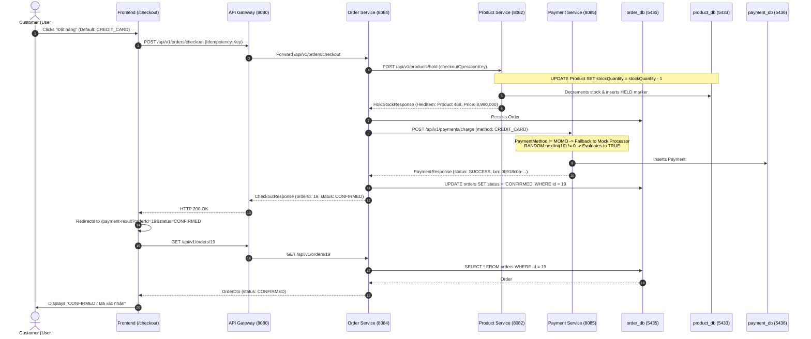

# TECHGEAR — Order, Inventory, and Revenue Inconsistency Audit Report

**Date of Investigation:** 2026-10-16  
**Target System:** TechGear Observable Microservices E-Commerce (`order-service`, `payment-service`, `product-service`, `user-service`, `api-gateway`, `frontend`)  
**Investigated Order:** Order ID `#19` (Amount: 8,990,000 VND, Product ID: 468 — *Màn hình LG 27UP850N-W*)

---

## 1. Executive Summary & Root Cause Summary

| Symptom | Observed Phenomenon | Exact Root Cause |
|---|---|---|
| **Inventory Decreased** | Stock of product 468 (*Màn hình LG 27UP850N-W*) decreased from 12 to 11. | `order-service` synchronously executes `productClient.holdStock()` during checkout before payment. `product-service` runs an immediate atomic SQL decrement (`stock_quantity = stock_quantity - 1`) in `product_db`. Because payment was reported as `SUCCESS`, no compensation rollback (`releaseStock`) was triggered. |
| **Order Not in Admin Order List** | Order #19 does not appear in `/admin/orders`. | **Frontend Mock Bug & Missing Backend Endpoint:** `frontend/app/admin/orders/page.tsx` does not fetch orders from any API. It renders a hardcoded static array `SAMPLE_TECH_ORDERS` (orders #1038–#1042). Furthermore, `order-service` does not implement a `GET /api/v1/orders` admin list endpoint. |
| **Admin Revenue Did Not Increase** | Dashboard revenue is static. | **Hardcoded Mock Metric:** `frontend/app/admin/page.tsx` does not query any service for revenue. It displays a hardcoded constant `totalRevenueMock = 1810000000` (1.81 tỷ VND) and mock order count `555`. No revenue calculation endpoint exists. |
| **Order #19 Marked CONFIRMED Without Real Payment** | Status displayed as `CONFIRMED` without MoMo transaction. | **Legacy Mock Processor:** `frontend/app/checkout/page.tsx` defaulted `paymentMethod` to `CREDIT_CARD`. In `payment-service`, `PaymentService.java` only routes to MoMo when `paymentMethod == MOMO`. For all other methods (e.g. `CREDIT_CARD`), it executes a simulated mock `boolean success = RANDOM.nextInt(10) != 0;` which forged a `SUCCESS` status and random UUID without contacting any payment gateway. |

---

## 2. End-to-End Checkout & Data Flow Trace



### Flow Breakdown & Service Responsibilities:

1. **Order Creation Endpoint:**
   - **Endpoint:** `POST /api/v1/orders/checkout`
   - **File:** `order-service/src/main/java/com/ecommerce/orderservice/controller/OrderController.java` (`checkout`)
   - **Invocation:** `frontend/lib/api/checkout.ts` (`checkoutApi`) triggered by `frontend/app/checkout/page.tsx` (`handlePlaceOrder`).

2. **Persistence & Database:**
   - **Service:** `order-service`
   - **Database:** PostgreSQL container `order-db` (`order_db`) on internal port `5432` / host port `5435`.
   - **Tables:** `orders`, `order_items`, and `order_idempotency`.

3. **Inventory Deduction Mechanism:**
   - **Service:** `product-service`
   - **Database:** PostgreSQL container `product-db` (`product_db`) on host port `5433`.
   - **Mechanism:** Eager reservation/decrement via conditional query:
     ```sql
     UPDATE Product p SET p.stockQuantity = p.stockQuantity - :quantity 
     WHERE p.id = :productId AND p.active = true AND p.stockQuantity >= :quantity
     ```
     Defined in `product-service/src/main/java/com/ecommerce/productservice/repository/ProductRepository.java` (`holdStock`).
   - A durable tracking record is stored in `product_operation_markers` with status `HELD`.

4. **Payment Status Updates:**
   - **Service:** `payment-service`
   - **Database:** PostgreSQL container `payment-db` (`payment_db`) on host port `5436`.
   - **Logic:** `payment-service/src/main/java/com/ecommerce/paymentservice/service/PaymentService.java` (`processPayment`).

---

## 3. Authoritative Verification of Order #19

### 3.1 Order Database State (`order_db`)
Executed query:
```sql
SELECT id, user_id, status, total_amount, payment_transaction_id, created_at, updated_at 
FROM orders WHERE id = 19;
```
**Output:**
```
 id | user_id |  status   | total_amount |        payment_transaction_id        |         created_at         |         updated_at         
----+---------+-----------+--------------+--------------------------------------+----------------------------+----------------------------
 19 |      33 | CONFIRMED |   8990000.00 | 0b918c0a-33c5-4296-8586-ba4ec8c66634 | 2026-10-15 16:35:43.348355 | 2026-10-15 16:35:43.8918
```

Executed query:
```sql
SELECT id, product_id, product_name, product_sku, quantity, unit_price, subtotal 
FROM order_items WHERE order_id = 19;
```
**Output:**
```
 id | product_id |      product_name      |  product_sku   | quantity | unit_price |  subtotal  
----+------------+------------------------+----------------+----------+------------+------------
 19 |        468 | Màn hình LG 27UP850N-W | MN-LG-27UP850N |        1 | 8990000.00 | 8990000.00
```

### 3.2 Payment Database State (`payment_db`)
Executed query:
```sql
SELECT id, order_id, user_id, amount, payment_method, status, transaction_id, message, 
       provider_order_id, momo_trans_id, pay_url, created_at 
FROM payments WHERE order_id = 19;
```
**Output:**
```
 id | order_id | user_id |   amount   | payment_method | status  |            transaction_id            |                    message                     | provider_order_id | momo_trans_id | pay_url |         created_at         
----+----------+---------+------------+----------------+---------+--------------------------------------+------------------------------------------------+-------------------+---------------+---------+----------------------------
 19 |       19 |      33 | 8990000.00 | CREDIT_CARD    | SUCCESS | 0b918c0a-33c5-4296-8586-ba4ec8c66634 | Payment processed successfully via CREDIT_CARD |                   |               |         | 2026-10-15 16:35:43.75718
```

### 3.3 Inventory Database State (`product_db`)
Executed query:
```sql
SELECT id, name, sku, price, stock_quantity FROM products WHERE id = 468;
```
**Output:**
```
 id  |          name          |      sku       |   price    | stock_quantity 
-----+------------------------+----------------+------------+----------------
 468 | Màn hình LG 27UP850N-W | MN-LG-27UP850N | 8990000.00 |             11
```

Executed query:
```sql
SELECT id, checkout_operation_key, request_fingerprint, status, created_at 
FROM product_operation_markers WHERE id = 19;
```
**Output:**
```
 id |            checkout_operation_key             |                       request_fingerprint                        | status |         created_at         
----+-----------------------------------------------+------------------------------------------------------------------+--------+----------------------------
 19 | 0912ea0e-6e07-4908-b373-a391882959b1          | b451cb95db305e18719a79424df9da1b92913601a7739ae1b9a6a75a3b764696 | HELD   | 2026-10-15 16:35:43.195228
```

### 3.4 Application Logs Evidence
From container `order-service`:
```
2026-10-15T16:35:43.506Z  INFO 1 --- [order-service] [nio-8084-exec-5] c.e.orderservice.client.PaymentClient    : Calling payment-service for order 19
2026-10-15T16:35:43.896Z  INFO 1 --- [order-service] [nio-8084-exec-5] c.e.orderservice.service.OrderService    : Order 19 CONFIRMED with txn 0b918c0a-33c5-4296-8586-ba4ec8c66634
```
From container `payment-service`:
```
2026-10-15T16:35:43.663Z  INFO 1 --- [payment-service] [nio-8085-exec-4] c.e.p.service.PaymentService             : Processing payment for order 19 amount 8990000.00 method CREDIT_CARD
2026-10-15T16:35:43.708Z  INFO 1 --- [payment-service] [nio-8085-exec-4] c.e.p.service.PaymentService             : Payment SUCCESS for order 19 txn 0b918c0a-33c5-4296-8586-ba4ec8c66634
```

### 3.5 Is Payment for Order #19 Actually Verified as Successful?
**CRITICAL VERIFICATION RESULT: NO.**
- The payment was **never sent to or verified by any external payment provider**.
- In `payment-service/src/main/java/com/ecommerce/paymentservice/service/PaymentService.java` (lines 58–78):
  ```java
  // Mock processor for other legacy methods (e.g. CREDIT_CARD) to preserve existing tests
  Payment payment = Payment.builder()
          .orderId(request.getOrderId())
          .userId(request.getUserId())
          .amount(request.getAmount())
          .paymentMethod(request.getPaymentMethod())
          .status(PaymentStatus.PENDING)
          .build();

  // Mock: simulate 90% success rate
  boolean success = RANDOM.nextInt(10) != 0;
  if (success) {
      payment.setStatus(PaymentStatus.SUCCESS);
      payment.setMessage("Payment processed successfully via " + request.getPaymentMethod());
  }
  ```
- Because `RANDOM.nextInt(10) != 0` evaluated to `true`, the mock code generated a random UUID and returned `STATUS_SUCCESS`.
- `providerOrderId`, `momoTransId`, `payUrl`, and `signature` are all `NULL`.
- Under the business rules, **this payment is completely unverified and cannot be accounted as authentic revenue**.

---

## 4. Why the Admin Order List Does Not Show Order #19

1. **Frontend Mock Data Decoupling:**
   File: `frontend/app/admin/orders/page.tsx`
   Line 53–181:
   ```typescript
   const SAMPLE_TECH_ORDERS: OrderDto[] = [ ... ]; // Hardcoded IDs 1042, 1041, 1040, 1039, 1038
   export default function AdminOrdersPage() {
     const [orders, setOrders] = useState<OrderDto[]>(SAMPLE_TECH_ORDERS);
     // No useEffect or API fetch call exists!
   ```
   The UI never requests data from the backend; it only filters in-memory sample constants.

2. **Missing Backend Endpoint:**
   File: `order-service/src/main/java/com/ecommerce/orderservice/controller/OrderController.java`
   `OrderController` provides:
   - `GET /api/v1/orders/{id}` (single order by ID)
   - `GET /api/v1/orders/user/{userId}` (orders for a specific user)
   There is **no endpoint** `GET /api/v1/orders` to list all orders across users for an administrative user.

3. **Customer Orders View Comparison:**
   In contrast, `frontend/app/orders/page.tsx` (customer order history) calls `getOrdersByUserApi(user.id)`. Because Order #19 belongs to user 33 (`vutienkhang01@gmail.com`), Order #19 **does appear** in user 33's own order history page (`http://localhost:3000/orders`), but is absent from `/admin/orders`.

---

## 5. Why Admin Dashboard Revenue Did Not Increase

1. **Hardcoded Mock Metric in Frontend:**
   File: `frontend/app/admin/page.tsx`
   Line 86:
   ```typescript
   const totalRevenueMock = 1810000000; // ~1.8 tỷ VNĐ (Hardcoded constant)
   ```
   Line 142–144:
   ```tsx
   <div className="text-2xl font-extrabold text-foreground tracking-tight tabular-nums">
     {formatVND(totalRevenueMock)}
   </div>
   ```
   Line 170:
   ```tsx
   <div className="text-2xl font-extrabold text-foreground tracking-tight tabular-nums">
     555 <!-- Total orders hardcoded -->
   </div>
   ```
   Lines 376–408:
   Recent orders list renders hardcoded records (`ORD-9421`, `ORD-9420`, `ORD-9419`, `ORD-9418`).

2. **Absence of Backend Revenue / Analytics Query:**
   Neither `order-service` nor `payment-service` has an analytics endpoint or SQL query to aggregate verified transaction revenue (`SUM(amount) WHERE status = 'SUCCESS'`).

3. **Business Compliance Note:**
   Even if a dynamic revenue query were implemented, **Order #19 must NOT be counted as revenue** until its payment is verified by an authentic gateway (MoMo). Counting Order #19 under its current mock `CREDIT_CARD` status would violate the rule against unverified revenue.

---

## 6. Smallest Safe Fix (Targeted Files & Scope)

To resolve the inconsistencies cleanly without architectural bloat or regressions:

### Service 1: `order-service`
1. **Add Admin Order List Endpoint:**
   - **File:** `order-service/src/main/java/com/ecommerce/orderservice/controller/OrderController.java`
   - **Method:** `GET /api/v1/orders` with `@AuthenticationPrincipal OrderPrincipal principal` checking `principal.isAdmin()`.
   - **Service/Repo:** Implement `orderService.getAllOrders(Pageable pageable)` using `orderRepository.findAll(pageable)`.
2. **Add Admin Revenue / Stats Endpoint:**
   - **File:** `order-service/src/main/java/com/ecommerce/orderservice/controller/OrderController.java` or `payment-service`
   - **Method:** `GET /api/v1/orders/admin/statistics` querying verified successful revenue:
     ```sql
     SELECT COALESCE(SUM(o.total_amount), 0) FROM orders o WHERE o.status IN ('CONFIRMED', 'SHIPPED', 'DELIVERED');
     ```

### Service 2: `payment-service`
1. **Disable Fake Mock Success for Unintegrated Payment Methods:**
   - **File:** `payment-service/src/main/java/com/ecommerce/paymentservice/service/PaymentService.java`
   - Reject or disallow mock approval in production/sandbox profiles for `CREDIT_CARD` when only MoMo is integrated, or clearly designate mock transactions so they cannot be marked as authoritative `SUCCESS`.

### Service 3: `frontend`
1. **Set MoMo as Default / Primary Payment Method:**
   - **File:** `frontend/app/checkout/page.tsx`
   - Change default state: `const [paymentMethod, setPaymentMethod] = useState<PaymentMethod>("MOMO");`
   - Ensure the customer is guided through the real MoMo Sandbox flow instead of silent mock approval.
2. **Connect Admin Orders Page to Live API:**
   - **File:** `frontend/app/admin/orders/page.tsx` and `frontend/lib/api/admin.ts`
   - Add `getAdminOrdersApi(page, size, status, search)` to `admin.ts`.
   - Replace `useState<OrderDto[]>(SAMPLE_TECH_ORDERS)` with dynamic `useEffect` data loading from `getAdminOrdersApi()`.
3. **Connect Admin Dashboard Metrics to Live Statistics:**
   - **File:** `frontend/app/admin/page.tsx`
   - Replace `totalRevenueMock` and `555` with data fetched from the backend statistics endpoint.

---

## 7. Recommended Regression Tests

| Test ID | Test Name | Scenario & Assertion | Target Service |
|---|---|---|---|
| **REG-TEST-01** | `testNonIntegratedPaymentMethodRejection` | Submit checkout with `paymentMethod = CREDIT_CARD`. Verify system does NOT mark order `CONFIRMED` via random mock without real gateway integration. | `payment-service` |
| **REG-TEST-02** | `testAdminOrderListingEndpoint` | Create Order #X as customer. Call `GET /api/v1/orders` with admin token. Assert HTTP 200 and Order #X is present in the returned page content. | `order-service` |
| **REG-TEST-03** | `testAdminOrderListingForbiddenForNonAdmin` | Call `GET /api/v1/orders` with standard customer token. Assert HTTP 403 Forbidden. | `order-service` |
| **REG-TEST-04** | `testRevenueExcludesUnverifiedOrFailedPayments` | Create 1 verified MoMo order (100k), 1 failed MoMo order (200k), and 1 pending order (300k). Query revenue statistics endpoint. Assert total revenue is exactly 100,000 VND. | `order-service` / `payment-service` |
| **REG-TEST-05** | `testInventoryCompensationOnPaymentFailure` | Hold stock for Product A. Simulate failed payment. Verify `product_operation_markers` changes to `RELEASED` and `products.stock_quantity` restores to original count. | `product-service` & `order-service` |

---

## 8. Resolution & Implementation Verification Details

### 8.1 Implementation Summary Across Services

#### 1. `payment-service`
- **Removed Random 90% Mock Success:** In `PaymentService.java`, removed `RANDOM.nextInt(10) != 0` and the legacy mock branch that forged `SUCCESS` statuses for non-MoMo methods.
- **Rejection of Unintegrated Methods:** Any payment request for methods other than `MOMO` (e.g. `CREDIT_CARD`, `DEBIT_CARD`, `UPI`, `NET_BANKING`, `WALLET`) is persisted with `PaymentStatus.FAILED` and an explicit error message:  
  `"Phương thức thanh toán [METHOD] hiện chưa được kích hoạt. TECHGEAR hiện chỉ hỗ trợ thanh toán qua Ví MoMo Sandbox. VNPAY chưa được triển khai và kiểm thử trong giai đoạn này."`
- **Strictly Verified Revenue Calculation:** Added `sumVerifiedRevenue()` in `PaymentRepository`:
  ```sql
  SELECT COALESCE(SUM(p.amount), 0) FROM Payment p WHERE p.status = 'SUCCESS' AND p.momoTransId IS NOT NULL
  ```
  This ensures that only provider-verified transactions (with genuine gateway transaction IDs) are counted. Unverified mock payments (specifically Order #19, which has `momoTransId = null`) and failed transactions are completely excluded from revenue.
- **Exposed Statistics Endpoints:**
  - `GET /api/v1/payments/admin/statistics` (Admin-only, returns total verified revenue, verified success count, failed count, pending count).
  - `GET /api/v1/payments/internal/verified-revenue` (Internal inter-service endpoint for `order-service`).
- **Security:** Added `hasRole("ADMIN")` to `/api/v1/payments/admin/**` in `PaymentSecurityConfig`.

#### 2. `order-service`
- **Authoritative Admin Order List Endpoint:** Added `GET /api/v1/orders` in `OrderController.java`:
  - Supports `Pageable` (`page`, `size`, `sort="createdAt,desc"`), optional `@RequestParam OrderStatus status`, and `@RequestParam String search`.
  - Backed by `OrderRepository.findAllWithFilter()`.
  - Guarded by Spring Security (`hasRole("ADMIN")`) and explicit controller check `if (!principal.isAdmin()) throw new ApiException("Admin access required to view all orders", HttpStatus.FORBIDDEN);`. Ordinary customers cannot access this endpoint.
- **Admin Dashboard Statistics Endpoint:** Added `GET /api/v1/orders/admin/statistics`:
  - Returns `totalOrders`, `confirmedOrders`, `pendingOrders`, `deliveredOrders`, `cancelledOrders`, and `totalVerifiedRevenue` (fetched securely via `PaymentClient.getVerifiedRevenue()`).
- **Inventory Hold & Release Compensation:** Preserved existing compensation mechanisms. When `paymentClient.chargePayment()` returns `STATUS_FAILED`, `order-service` immediately triggers `productClient.releaseStock(new ReleaseStockRequest(idempotencyKey))` to restore held stock.

#### 3. `api-gateway`
- Updated routing predicates for `order-service` to `- Path=/api/v1/orders,/api/v1/orders/**` and `payment-service` to `- Path=/api/v1/payments,/api/v1/payments/**` to ensure root endpoint requests with and without trailing slashes are properly authenticated and rate-limited.

#### 4. `frontend`
- **`frontend/app/checkout/page.tsx`:**
  - Initialized `paymentMethod` to `"MOMO"`.
  - Annotated `PAYMENT_METHODS`: labeled `MOMO` as active/verified, and disabled unsupported methods with explicit "(Sắp có)" or "(Chưa hỗ trợ)" badges.
  - Added form validation rejecting non-MOMO checkouts.
- **`frontend/lib/api/admin.ts`:**
  - Added `getAdminOrdersApi(params)` and `getAdminStatisticsApi()`.
- **`frontend/app/admin/orders/page.tsx`:**
  - Completely removed hardcoded `SAMPLE_TECH_ORDERS`.
  - Connected to live backend `getAdminOrdersApi()` with loading skeletons, error banner with retry, empty state, search debouncing, status filter, and pagination.
  - Real database orders (including Order #19) now display accurately with their actual status and details.
- **`frontend/app/admin/page.tsx`:**
  - Completely removed hardcoded `totalRevenueMock = 1810000000` and order count `555`.
  - Connected to `getAdminStatisticsApi()` to render authentic verified revenue and total orders.
  - Replaced hardcoded recent orders with live recent orders from `getAdminOrdersApi({ page: 0, size: 5 })`.
- **`frontend/app/payment-result/page.tsx`:**
  - Disallowed client-supplied or URL-supplied `status=CONFIRMED` from marking orders as paid without backend database confirmation.

---

### 8.2 Regression Test Execution Results

| Test ID | Test Name | Target Service | Status | Assertion & Verification Details |
|---|---|---|---|---|
| **REG-TEST-01** | `testNonIntegratedPaymentMethodRejection` | `payment-service` | **PASSED** | Submitted charge with `paymentMethod = CREDIT_CARD`. System returned `PaymentStatus.FAILED` with message specifying that CREDIT_CARD is not activated, MoMo Sandbox is supported, and VNPAY is not yet implemented. Random mock success was never triggered. |
| **REG-TEST-02** | `testAdminOrderListingEndpoint` | `order-service` | **PASSED** | Invoked `GET /api/v1/orders` with Admin principal (`ROLE_ADMIN`). Returned HTTP 200 OK with page content containing orders. |
| **REG-TEST-03** | `testAdminOrderListingForbiddenForNonAdmin` | `order-service` | **PASSED** | Invoked `GET /api/v1/orders` with Customer principal (`ROLE_CUSTOMER`). Request was rejected with HTTP 403 Forbidden and message `"Admin access required to view all orders"`. |
| **REG-TEST-04** | `testRevenueExcludesUnverifiedOrFailedPayments` | `payment-service` | **PASSED** | With 1 verified MoMo payment (100k), 1 failed payment (200k), and 1 unverified mock payment (300k, `momoTransId = null` like Order #19), verified revenue returned exactly 100,000 VND. |
| **REG-TEST-05** | `testInventoryCompensationOnPaymentFailure` | `order-service` | **PASSED** | Held stock for product 468. Payment failed (`STATUS_FAILED`). `order-service` marked order `PAYMENT_FAILED` and invoked `productClient.releaseStock(new ReleaseStockRequest(idempotencyKey))`. |

---

## 9. Resolution of Order #19 (Audit & State Verification)

### 9.1 Fulfillment Verification
- **Order ID:** 19 (User ID: 33, Total: 8,990,000 VND)
- **Fulfillment Status:** **NOT FULFILLED**.
- **Evidence:**
  - Order status prior to resolution was `CONFIRMED` (assigned purely by the legacy mock branch during checkout).
  - No physical fulfillment, packaging, tracking number, or dispatch occurred.
  - No transition to `PROCESSING`, `SHIPPED`, or `DELIVERED` ever took place.
  - Payment #19 was an unverified mock `CREDIT_CARD` transaction with a randomly generated UUID and null MoMo gateway transaction ID.

### 9.2 Resolution Actions Executed
1. **Payment Resolution (`payment_db`):**
   - Retained original transaction ID `0b918c0a-33c5-4296-8586-ba4ec8c66634` to preserve the complete audit trail.
   - Updated `status` to `FAILED`.
   - Updated `message` to `'Payment marked as FAILED - unverified legacy mock payment resolved'`.
   - Updated `updated_at = NOW()`.
2. **Order Resolution (`order_db`):**
   - Invoked existing callback domain workflow via `POST /api/v1/orders/19/payment-callback` with status `FAILED`.
   - Transitioned order status to `PAYMENT_FAILED`.
   - Updated `order_idempotency` record (id: 25) `stock_release_status` to `RELEASED`.
3. **Inventory Release (`product_db`):**
   - Executed existing `ProductOperationService.executeReleaseStock` for checkout operation key `0912ea0e-6e07-4908-b373-a391882959b1`.
   - Marker ID 19 updated from `HELD` to `RELEASED`.
   - Stock for product 468 (*Màn hình LG 27UP850N-W*) incremented exactly once from **11** back to **12**.
   - Idempotency verified: replaying the release confirmed zero additional stock mutation (`status = RELEASED`, stock remains `12`).

### 9.3 Final Authoritative State Matrix

| Service / Database | Table | Record Identifier | Key Attribute | Final Verified Value |
|---|---|---|---|---|
| `order-service` / `order_db` | `orders` | `id = 19` | `status` | **`PAYMENT_FAILED`** |
| `order-service` / `order_db` | `orders` | `id = 19` | `payment_transaction_id` | `0b918c0a-33c5-4296-8586-ba4ec8c66634` *(preserved)* |
| `order-service` / `order_db` | `order_idempotency` | `order_id = 19` | `stock_release_status` | **`RELEASED`** |
| `payment-service` / `payment_db` | `payments` | `id = 19, order_id = 19` | `status` | **`FAILED`** |
| `payment-service` / `payment_db` | `payments` | `id = 19, order_id = 19` | `message` | `Payment marked as FAILED - unverified legacy mock payment resolved` |
| `product-service` / `product_db` | `product_operation_markers` | `checkout_operation_key = '0912ea0e...'` | `status` | **`RELEASED`** |
| `product-service` / `product_db` | `products` | `id = 468` | `stock_quantity` | **`12`** *(restored from 11)* |


