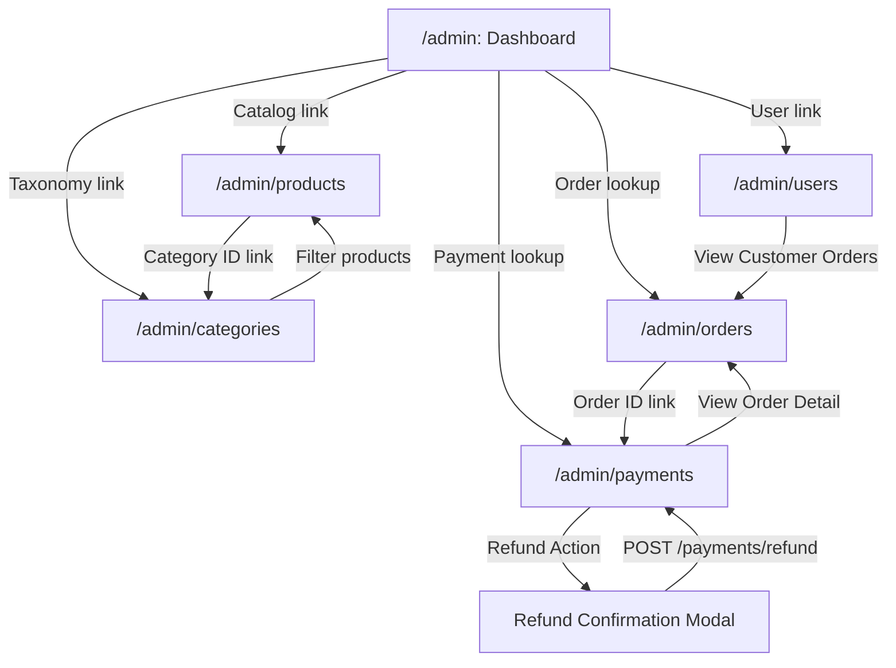

# TECHGEAR — ADMIN-01 Admin Sitemap, Navigation & Scope Specification

> **Document ID:** ADMIN-01-ADMIN-SITEMAP-FLOW  
> **Topic:** Admin Portal Sitemap, Navigation Architecture, Actor Boundaries, API Inventory & Flow Contracts  
> **Target Scope:** Whole-Admin Specification & Architectural Scope Pre-Flight  
> **Source Documents:** [FE-01](file:///d:/CODE/WebJava/observable-microservices-ecommerce/frontend/docs/FE-01-CATALOG-SITEMAP-FLOW.md), [FE-DESIGN-SYSTEM](file:///d:/CODE/WebJava/observable-microservices-ecommerce/frontend/docs/FE-DESIGN-SYSTEM.md), [FE-15](file:///d:/CODE/WebJava/observable-microservices-ecommerce/frontend/docs/FE-15-AUTH-GUARD-LOGOUT-DESIGN.md)  
> **Backend Authority:** Spring Boot 3.2 Services (`api-gateway`, `user-service`, `product-service`, `order-service`, `payment-service`)  
> **Status:** APPROVED & SPECIFIED — Strict YAGNI — Backend-Grounded

---

## 1. Executive Summary & Purpose

The **Admin Portal Specification** (`ADMIN-01`) defines the complete administrative scope, sitemap, navigation hierarchy, security boundaries, and API integration contracts for TECHGEAR prior to designing individual screens. 

### Core Architectural Principles
1. **Single Admin Actor:** Exactly one administrative role exists across all microservices: `ADMIN`. There are no intermediate tiers (`SUPER_ADMIN`, `MODERATOR`, `STAFF`, or `MANAGER`).
2. **Backend as Ultimate Authority:** Frontend role guards act strictly as a client-side UX navigation layer. All administrative operations are enforced by backend Spring Security filters (`hasRole('ADMIN')` and method-level `@PreAuthorize`).
3. **Strict Grounding in Existing Microservices:** The Admin Portal interacts exclusively with the existing, frozen Spring Boot 3.2 microservices. No new administrative microservice, no new database tables, no fake analytics services, and no background reporting jobs are introduced.
4. **Honest Data Boundaries:** The backend exposes **no aggregate analytics or dashboard endpoints**, and **no unbounded `/orders` or `/payments` list endpoints**. The Admin UI is designed strictly around realistic lookup patterns, single-record inspections, direct CRUD forms, and lightweight count aggregations available from active endpoints.
5. **No Stitch Screen / No Code Implementation:** ADMIN-01 serves strictly as the foundational specification document for screens `ADMIN-02` through `ADMIN-07`.

---

## 2. Admin Actor & Security Authorization

### 2.1 Actor Definition & Role Grounding
* **Only Actor:** `ADMIN` (`BACKEND-CONFIRMED`).
* **Source Reference:** `user-service` / `UserRole.java:3-6`:
  ```java
  public enum UserRole {
      CUSTOMER,
      ADMIN
  }
  ```
* **Claim Propagation:**
  * When an admin logs in via `POST /api/v1/auth/login`, `user-service` embeds `"role": "ADMIN"` into the signed JWT token claims and populates `user.role: "ADMIN"` inside `AuthResponse`.
  * Downstream microservices parse the verified token (`OrderPrincipal.isAdmin()`, `PaymentPrincipal.isAdmin()`, `UserDetails.getAuthorities()`) to grant administrative access.

### 2.2 Permissions & Access Boundary Matrix

| Capability Category | Customer Role (`CUSTOMER`) | Admin Role (`ADMIN`) | Enforcement Layer & Source Reference |
| :--- | :---: | :---: | :--- |
| **Storefront & Catalog Browsing** | Allowed | Allowed | Public browse (`product-service`). |
| **Personal Cart & Checkout** | Allowed | Allowed | Authenticated (`OrderSecurityConfig.java:47`). |
| **Personal Profile (`/users/me`)** | Allowed (Own) | Allowed (Own) | Authenticated (`UserController.java:23-37`). |
| **List All Users (`GET /users`)** | **FORBIDDEN (403)** | **ALLOWED** | `@PreAuthorize("hasRole('ADMIN')")` (`UserController.java:41`). |
| **Get User by ID (`GET /users/{id}`)** | **FORBIDDEN (403)** | **ALLOWED** | `@PreAuthorize("hasRole('ADMIN')")` (`UserController.java:48`). |
| **Delete User (`DELETE /users/{id}`)** | **FORBIDDEN (403)** | **ALLOWED** | `@PreAuthorize("hasRole('ADMIN')")` (`UserController.java:55`). |
| **Create Product (`POST /products`)** | Forbidden at Gateway / Open internal | **ALLOWED** | Protected route (`ProductController.java:74`). |
| **Edit Product (`PATCH /products/{id}`)** | Forbidden at Gateway / Open internal | **ALLOWED** | Protected route (`ProductController.java:79`). |
| **Update Inventory (`PATCH /products/{id}/inv`)**| Forbidden at Gateway / Open internal | **ALLOWED** | Protected route (`ProductController.java:86`). |
| **Delete Product (`DELETE /products/{id}`)** | Forbidden at Gateway / Open internal | **ALLOWED** | Soft-delete (`ProductController.java:93`). |
| **Create/Edit/Delete Category** | Forbidden at Gateway / Open internal | **ALLOWED** | Category CRUD (`CategoryController.java:31-48`). |
| **Inspect Any Order by ID** | **FORBIDDEN (403)** if not owner | **ALLOWED** (Any) | Ownership check bypassed for admin (`OrderController.java:116`). |
| **Inspect Any User's Orders** | **FORBIDDEN (403)** if not owner | **ALLOWED** (Any) | Ownership check bypassed for admin (`OrderController.java:127`). |
| **Update Order Status** | **FORBIDDEN (403)** | **ALLOWED** | `hasRole('ADMIN')` (`OrderSecurityConfig.java:48`). |
| **Cancel Any Order** | Allowed (Own eligible) | **ALLOWED** (Any eligible)| Admin bypasses userId check (`OrderController.java:136`). |
| **Inspect Any Payment Record** | **FORBIDDEN (403)** if not owner | **ALLOWED** (Any) | `PaymentPrincipal.isAdmin()` (`PaymentController.java:54, 64, 77`). |
| **Process Payment Refund** | **FORBIDDEN (403)** | **ALLOWED** | `hasRole('ADMIN')` (`PaymentSecurityConfig.java:48`, `PaymentController.java:44`). |

---

## 3. Admin Sitemap & Route Architecture

The Admin Portal sitemap strictly mirrors active backend capabilities. Zero speculative analytics or reporting routes are included:

```
TECHGEAR ADMIN SITEMAP
├── /admin                      [ADMIN-02: Dashboard Overview & Module Navigation]
├── /admin/products             [ADMIN-03: Product Management — List, Filter, Inventory & CRUD]
├── /admin/categories           [ADMIN-04: Category Management — List, Create, Edit & Delete]
├── /admin/users                [ADMIN-05: User Directory — List, Profile Inspection & Account Deletion]
├── /admin/orders               [ADMIN-06: Order Operations — Order ID / User ID Lookup & Status Update]
└── /admin/payments             [ADMIN-07: Payment Operations — Transaction Lookup & Refund Processing]
```

### Route Scope Verification & Exclusions
* **Retained Routes (6 Screens Total):**
  1. `/admin`: Central operational overview, quick navigation hub, and active entity count vitrine.
  2. `/admin/products`: Full catalog management (paginated table, keyword search, create modal/form, edit details, adjust stock quantity).
  3. `/admin/categories`: Category taxonomy management (list active, create new, edit metadata, soft-delete with active product safety check).
  4. `/admin/users`: User management (list all registered users, inspect profile metadata, delete user).
  5. `/admin/orders`: Order management (direct lookup by Order ID or User ID, inspect items & shipping, transition order status).
  6. `/admin/payments`: Payment management (lookup by Payment ID, Order ID, or User ID, trigger transaction refund with reason).
* **Explicitly Excluded Routes (`SCOPE LIMITATION`):**
  * `/admin/analytics`: Excluded (no backend aggregation or timeseries metrics engine).
  * `/admin/reports`: Excluded (no export, PDF generator, or CSV reporting microservice).
  * `/admin/settings`: Excluded (no system configuration or tenant management API).
  * `/admin/inventory-dashboard`: Excluded (inventory managed directly inside `/admin/products`).
  * `/admin/customers/segments`: Excluded (no CRM, segmentation, or tagging API).
  * `/admin/audit-log`: Excluded (no centralized audit trail inspection API).

---

## 4. Admin Navigation Architecture

The Admin Portal uses a high-density, pragmatic sidebar or sticky top rail tailored for desktop efficiency.

### 4.1 Navigation Structure
```
┌────────────────────────────────────────────────────────────────────────┐
│ TECHGEAR // ADMIN                                     [ADMINISTRATOR]  │
├───────────┬────────────────────────────────────────────────────────────┤
│           │                                                            │
│ Dashboard │  ACTIVE MODULE CONTENT AREA                                │
│ Products  │  (High-density tables, compact filters, action buttons)    │
│ Categories│                                                            │
│ Users     │                                                            │
│ Orders    │                                                            │
│ Payments  │                                                            │
│           │                                                            │
│ ───────── │                                                            │
│ Log Out   │                                                            │
└───────────┴────────────────────────────────────────────────────────────┘
```

### 4.2 Navigation Item Specifications
* **Brand Wordmark:** `TECHGEAR // ADMIN` (Plus Jakarta Sans `14px`, Bold `#1C1917`, uppercase with JetBrains Mono `11px` `#78716C` separator).
* **Primary Navigation Links:**
  * **Dashboard:** `/admin` (Landing view and operational shortcuts).
  * **Products:** `/admin/products` (Catalog table & stock stepper).
  * **Categories:** `/admin/categories` (Category list & management).
  * **Users:** `/admin/users` (User directory).
  * **Orders:** `/admin/orders` (Order lookup & status transitions).
  * **Payments:** `/admin/payments` (Transaction lookup & refund action).
* **Utility Rail / Session:**
  * **Admin Identity Indicator:** Displays logged-in admin email and `ADMIN` badge (`JetBrains Mono 10px`, `#1C1917` on `#F5F5F4`).
  * **Log Out Action:** Triggers client-side auth state purge and navigates to `/login` (FE-15 flow).
* **Navigation Restraints:** No multi-level mega-menus, no collapsible sub-accordions, no notification bell popovers, and no speculative settings icons.

---

## 5. Comprehensive API Inventory

Every action available in the Admin Portal maps 1-to-1 with audited Spring Boot controller methods:

| Screen | Admin Action | HTTP Method | Endpoint | Auth & Role | Request Payload / Query Params | Response Type | Backend Limitations & Notes |
| :--- | :--- | :---: | :--- | :---: | :--- | :--- | :--- |
| **ADMIN-02 Dashboard** | Get Product Count | `GET` | `/api/v1/products?size=1` | Public / Token | Query: `size=1` | `Page<ProductDto>` | Reads `totalElements` field for product count. |
| **ADMIN-02 Dashboard** | Get Category Count | `GET` | `/api/v1/categories` | Public / Token | None | `List<CategoryDto>` | Reads `list.size()` for active categories. |
| **ADMIN-02 Dashboard** | Get User Count | `GET` | `/api/v1/users` | `ADMIN` | None | `List<UserProfileDto>` | Reads `list.size()` for registered users. Used solely to obtain count (backend does not expose aggregate/count API). |
| **ADMIN-03 Products** | List Products | `GET` | `/api/v1/products` | Public / Token | `page`, `size`, `sort` | `Page<ProductDto>` | Standard Spring Data pagination (default `size=20`). |
| **ADMIN-03 Products** | Search Products | `GET` | `/api/v1/products/search` | Public / Token | `keyword`, `page`, `size` | `Page<ProductDto>` | Full-text search across name/description. |
| **ADMIN-03 Products** | Get Product Detail | `GET` | `/api/v1/products/{id}` | Public / Token | Path: `id: Long` | `ProductDto` | Single product inspection. |
| **ADMIN-03 Products** | Create Product | `POST` | `/api/v1/products` | `ADMIN` | `CreateProductRequest` | `ProductDto` (201 Created) | Requires `name`, `sku`, `price`, `stockQuantity`, `categoryId`. |
| **ADMIN-03 Products** | Update Product Details | `PATCH` | `/api/v1/products/{id}` | `ADMIN` | `UpdateProductRequest` | `ProductDto` (200 OK) | Updates `name`, `description`, `price`, `imageUrl`, `categoryId`, `active`. Does not update stock. |
| **ADMIN-03 Products** | Update Stock / Inventory| `PATCH` | `/api/v1/products/{id}/inventory`| `ADMIN` | `InventoryUpdateRequest` | `ProductDto` (200 OK) | `mode`: `ABSOLUTE` or `DELTA`; `quantity`: integer. Stock cannot be negative. |
| **ADMIN-03 Products** | Delete Product | `DELETE` | `/api/v1/products/{id}` | `ADMIN` | Path: `id: Long` | `204 No Content` | Soft-deletes product (`active = false`). |
| **ADMIN-04 Categories**| List Active Categories | `GET` | `/api/v1/categories` | Public / Token | None | `List<CategoryDto>` | Returns all active categories (unpaginated). |
| **ADMIN-04 Categories**| Get Category by ID | `GET` | `/api/v1/categories/{id}` | Public / Token | Path: `id: Long` | `CategoryDto` | Single category inspection. |
| **ADMIN-04 Categories**| Create Category | `POST` | `/api/v1/categories` | `ADMIN` | `CreateCategoryRequest` | `CategoryDto` (201 Created) | Requires `name` (2–100 chars), optional `description`, `imageUrl`. |
| **ADMIN-04 Categories**| Update Category | `PUT` | `/api/v1/categories/{id}` | `ADMIN` | `CreateCategoryRequest` | `CategoryDto` (200 OK) | Updates `name`, `description`, `imageUrl`. |
| **ADMIN-04 Categories**| Delete Category | `DELETE` | `/api/v1/categories/{id}` | `ADMIN` | Path: `id: Long` | `204 No Content` | Soft-deletes (`active = false`). Fails with 409 if active products reference it. |
| **ADMIN-05 Users** | List All Users | `GET` | `/api/v1/users` | `ADMIN` | None | `List<UserProfileDto>` | Unpaginated list of all users (`UserController.java:42`). |
| **ADMIN-05 Users** | Get User Detail | `GET` | `/api/v1/users/{id}` | `ADMIN` | Path: `id: Long` | `UserProfileDto` | Single user inspection by ID. |
| **ADMIN-05 Users** | Delete User | `DELETE` | `/api/v1/users/{id}` | `ADMIN` | Path: `id: Long` | `204 No Content` | Permanently deletes user entity from database (`userRepository.deleteById`). |
| **ADMIN-06 Orders** | Lookup Single Order | `GET` | `/api/v1/orders/{id}` | `ADMIN` | Path: `id: Long` | `OrderDto` (200 OK) | Admin bypasses customer ownership check. |
| **ADMIN-06 Orders** | Lookup User Orders | `GET` | `/api/v1/orders/user/{userId}`| `ADMIN` | `userId`, `page`, `size` | `Page<OrderDto>` | Admin can inspect any customer's paginated order list. |
| **ADMIN-06 Orders** | Update Order Status | `PATCH` | `/api/v1/orders/{id}/status` | `ADMIN` | Query: `status: OrderStatus` | `OrderDto` (200 OK) | Transitions status to any valid `OrderStatus`. |
| **ADMIN-06 Orders** | Cancel Order | `POST` | `/api/v1/orders/{id}/cancel` | `ADMIN` | Path: `id: Long` | `OrderDto` (200 OK) | Admin bypasses ownership. Order must be `PENDING` or `CONFIRMED`. |
| **ADMIN-07 Payments** | Lookup Payment by ID | `GET` | `/api/v1/payments/{id}` | `ADMIN` | Path: `id: Long` | `PaymentResponse` (200 OK)| Admin bypasses ownership. Single transaction receipt. |
| **ADMIN-07 Payments** | Lookup Payments by Order| `GET` | `/api/v1/payments/order/{orderId}`| `ADMIN` | Path: `orderId: Long` | `List<PaymentResponse>` | Admin inspects all payment attempts for an order. |
| **ADMIN-07 Payments** | Lookup Payments by User | `GET` | `/api/v1/payments/user/{userId}` | `ADMIN` | Path: `userId: Long` | `List<PaymentResponse>` | Admin inspects all payment history for a customer. |
| **ADMIN-07 Payments** | Process Refund | `POST` | `/api/v1/payments/refund` | `ADMIN` | `RefundRequest` (`paymentId`, `reason`)| `PaymentResponse` (200 OK)| Payment must be in `SUCCESS` status. Transitions to `REFUNDED`. |

---

## 6. Dashboard Scope & Real-Data Boundaries

### 6.1 Operational Overview Definition & Explicit Exclusions
* **`SCOPE LIMITATION` / `BACKEND-CONFIRMED`:**
  * The Admin Dashboard (`/admin`) is **strictly an Operational Overview** and navigation hub.
  * The backend provides **zero aggregate analytics endpoints** (no `/api/v1/analytics/dashboard`, no `/api/v1/orders/stats`, no `/api/v1/revenue`).
  * The backend provides **no unbounded order or payment listing** endpoints (`GET /api/v1/orders` does not exist; `GET /api/v1/payments` does not exist).
* **Strict Operational Constraints (No Fake Analytics / No Background Polling):**
  * **No polling:** Metrics are loaded strictly once upon page navigation.
  * **No periodic refresh:** No background intervals, timers, or WebSocket subscriptions.
  * **No charts:** No line graphs, bar charts, pie charts, sparklines, or SVG telemetry curves.
  * **No historical analytics:** No date-range pickers, day/month filters, or comparisons.
  * **No trend calculation:** No artificial percentage changes (e.g. "+5.4% this week").
  * **No analytics aggregation:** No client-side scraping or heavy calculation loops over raw records.
* **Registered User Metric Grounding:**
  * `GET /api/v1/users` is used **strictly to extract `size()`** (`List<UserProfileDto>.size()`) because the backend currently does not expose a dedicated count or aggregate user endpoint.
  * **No new aggregate API is created.**

### 6.2 Realistic Dashboard Layout (`ADMIN-02`)
The Dashboard is defined as an **Operational Overview & Navigation Landing Page**:
1. **Entity Count Vitrine (3 Operational Metrics Only):**
   * **Product Total:** Extracted dynamically from `Page<ProductDto>.totalElements` via `GET /api/v1/products?size=1`.
   * **Active Category Total:** Extracted dynamically from `List<CategoryDto>.size()` via `GET /api/v1/categories`.
   * **Registered User Total:** Extracted strictly from `List<UserProfileDto>.size()` via `GET /api/v1/users` (read-only count calculation; no aggregate API created).
2. **Operational Jump Stations (Quick Actions):**
   * `[ + NEW PRODUCT ]` &rarr; Navigates to `/admin/products`.
   * `[ + NEW CATEGORY ]` &rarr; Navigates to `/admin/categories`.
   * `[ LOOKUP ORDER ]` &rarr; Direct ID input field leading to `/admin/orders?orderId=...`.
   * `[ LOOKUP PAYMENT ]` &rarr; Direct ID input field leading to `/admin/payments?paymentId=...`.
3. **Module Navigation Cards:** Clean editorial cards linking directly to the 5 operational modules with concise scope descriptions.

---

## 7. Product Management Scope (`ADMIN-03`)

* **Supported Capabilities (`BACKEND-CONFIRMED`):**
  * Paginated table listing active and inactive products (`GET /api/v1/products`).
  * Full-text search by keyword (`GET /api/v1/products/search?keyword=...`).
  * Category filtering (`GET /api/v1/products/category/{categoryId}`).
  * Creation of new products (`POST /api/v1/products`) with strict validation:
    * `name`: 2–200 characters.
    * `sku`: Uppercase alphanumeric with hyphens (e.g. `TG-AUD-001`).
    * `price`: Decimal format (> 0).
    * `stockQuantity`: Non-negative integer.
    * `categoryId`: Valid category ID reference.
    * `imageUrl`: Valid URL string.
  * In-place or form editing of product metadata (`PATCH /api/v1/products/{id}`).
  * Inventory management (`PATCH /api/v1/products/{id}/inventory`):
    * Mode `ABSOLUTE`: Directly resets stock level (must be &ge; 0).
    * Mode `DELTA`: Increments or decrements stock by integer delta.
  * Soft-deletion (`DELETE /api/v1/products/{id}`), which sets `active = false` without corrupting historical orders.
* **Scope Exclusions (`SCOPE LIMITATION`):**
  * No CSV / Excel bulk upload.
  * No multi-image gallery or asset upload server (accepts static image URLs).
  * No variant matrix (products are flat catalog entities).
  * No product tags, reviews, customer ratings, or promotional discounts.

---

## 8. Category Management Scope (`ADMIN-04`)

* **Supported Capabilities (`BACKEND-CONFIRMED`):**
  * Full list view of active categories (`GET /api/v1/categories`).
  * Creation of new category (`POST /api/v1/categories` with `CreateCategoryRequest`):
    * `name`: 2–100 characters, required.
    * `description`: Max 500 characters, optional.
    * `imageUrl`: String URL, optional.
  * Edit category details (`PUT /api/v1/categories/{id}`).
  * Soft-deletion of category (`DELETE /api/v1/categories/{id}`):
    * **Backend Constraint:** If active products currently reference the category (`productRepository.existsByCategoryIdAndActiveTrue(id)`), backend returns **HTTP 409 Conflict** (`CategoryInUseException`). The UI must display an inline warning informing the admin that referencing products must be reassigned or deleted first.
* **Scope Exclusions (`SCOPE LIMITATION`):**
  * No hierarchical/nested subcategories (flat 1-level category taxonomy).
  * No category drag-and-drop reordering.
  * No category marketing banners or SEO metadata managers.

---

## 9. User Directory Scope (`ADMIN-05`)

* **Supported Capabilities (`BACKEND-CONFIRMED`):**
  * Full list view of all registered system users (`GET /api/v1/users`).
  * Single user detail view (`GET /api/v1/users/{id}`):
    * Inspect `id`, `firstName`, `lastName`, `email`, `phone`, `role` (`CUSTOMER` / `ADMIN`), `enabled` status, `createdAt`, `updatedAt`.
  * User deletion (`DELETE /api/v1/users/{id}`):
    * Permanent removal of user record via `userRepository.deleteById`. UI requires explicit confirmation modal.
  * Cross-navigation shortcut to inspect user's orders (`/admin/orders?userId={id}`).
* **Scope Exclusions (`SCOPE LIMITATION`):**
  * No admin-side password resets or credential modifications.
  * No admin user editing (backend only supports self-profile update via `/users/me`).
  * No user impersonation ("Login as user") mechanism.
  * No user tagging, CRM notes, or export buttons.

---

## 10. Order Operations Scope (`ADMIN-06`)

### 10.1 Order Lookup Constraints (`BACKEND-CONFIRMED`)
* Because `order-service` does not have an unbounded `GET /api/v1/orders` endpoint, the Admin Orders interface operates via targeted lookups:
  1. **Direct Order Lookup:** Input field allowing lookup by numeric `orderId` (`GET /api/v1/orders/{id}`).
  2. **Customer Order Lookup:** Input field or link allowing lookup by `userId` (`GET /api/v1/orders/user/{userId}`), returning a paginated history.

### 10.2 Order Lifecycle & Status Management
* **Exact Backend `OrderStatus` Enum (9 States):**
  1. `PENDING`
  2. `CONFIRMED`
  3. `PAYMENT_FAILED`
  4. `PAYMENT_UNKNOWN`
  5. `PROCESSING`
  6. `SHIPPED`
  7. `DELIVERED`
  8. `CANCELLED`
  9. `REFUNDED`
* **Admin Status Update Capability:**
  * Admin can transition order status via `PATCH /api/v1/orders/{id}/status?status={newStatus}`.
  * Status picker presents the exact backend enum values.
* **Order Cancellation:**
  * Admin can execute order cancellation via `POST /api/v1/orders/{id}/cancel`.
  * Can only be triggered if current status is `PENDING` or `CONFIRMED`. If attempted on other states, backend throws `OrderStatusException` (HTTP 422).
* **Scope Exclusions (`SCOPE LIMITATION`):**
  * No courier tracking, shipping webhook listeners, or waybill printing.
  * No manual line-item editing on existing orders.
  * No VAT invoice generator.

---

## 11. Payment Operations Scope (`ADMIN-07`)

### 11.1 Transaction Lookup Constraints (`BACKEND-CONFIRMED`)
* The payment service provides three targeted query vectors (no unbounded list):
  1. **By Payment ID:** `GET /api/v1/payments/{id}` &rarr; returns single `PaymentResponse`.
  2. **By Order ID:** `GET /api/v1/payments/order/{orderId}` &rarr; returns list of payment attempts for that order.
  3. **By User ID:** `GET /api/v1/payments/user/{userId}` &rarr; returns list of payments made by that customer.

### 11.2 Refund Processing Engine & Contract Verification
* **Endpoint:** `POST /api/v1/payments/refund` (`PaymentSecurityConfig.java:48` requires `hasRole('ADMIN')`).
* **Source of Truth Verification (`RefundRequest.java:8-15`):**
  * Exact fields defined in `com.ecommerce.paymentservice.dto.RefundRequest`:
    1. `paymentId` (`Long`): `@NotNull(message = "Payment ID is required")`
    2. `reason` (`String`): `@NotBlank(message = "Reason is required")`
  * **Exact Request JSON Payload:**
    ```json
    {
      "paymentId": 105,
      "reason": "Customer requested cancellation prior to shipment"
    }
    ```
* **UI Refund Modal Scope (Exact Fields Only):**
  * The UI refund modal renders **ONLY the exact fields backend requires**:
    * `Payment ID` (`paymentId`): Pre-populated and bound from the selected payment record (read-only reference).
    * `Reason` (`reason`): Required text input / textarea for admin explanation.
  * **Zero Extra / Invented Fields:**
    * No refund amount field (backend does not accept partial amounts; full transaction amount is refunded).
    * No bank account or gateway selection fields.
    * No multi-step approval workflow.
* **Strict Business Logic & Error Rules:**
  * Payment **must** currently be in `PaymentStatus.SUCCESS`.
  * If payment is in `PENDING`, `FAILED`, or `REFUNDED`, backend rejects with **HTTP 400 Bad Request** (`PaymentProcessingException`: `"Cannot refund payment in status: ..."`).
  * Upon success, payment transitions to `REFUNDED` and updates message string to `"Refunded. Reason: {reason}"`.
* **Scope Exclusions (`SCOPE LIMITATION`):**
  * No direct gateway credential settings or Stripe dashboard embeds.
  * No partial refunds (backend refunds full transaction amount).
  * No raw credit card, CVV, or banking details displayed.

---

## 12. Cross-Screen Operational Flows

The Admin Portal links workflows together seamlessly without dead ends:



### Detailed Operational Workflows:
1. **Catalog to Category Flow:** 
   * Thao tác từ Products điều hướng trực tiếp: `Products` &rarr; `/admin/categories` (hoặc không cần navigation nếu thông tin danh mục đã hiển thị đầy đủ trong bảng sản phẩm).
   * **Loại bỏ toàn bộ cross-screen behavior "click Category ID → Category Drawer". KHÔNG tạo Drawer component/spec.**
2. **User to Orders Flow:** Inside `/admin/users`, each user row includes an action `[ View Orders ]` linking directly to `/admin/orders?userId={id}`, loading their purchase history.
3. **Order to Payment Audit Flow:** Inside `/admin/orders`, inspecting an order displays its `paymentTransactionId` and provides a direct jump button `[ Inspect Payment ]` to `/admin/payments?orderId={id}`.
4. **Payment Refund Flow:** Inside `/admin/payments`, inspecting a successful payment displays a prominent `[ ISSUE REFUND ]` button. Clicking prompts a modal requesting a mandatory reason string before executing `POST /api/v1/payments/refund`.

---

## 13. Security, Guard & Session Architecture

The Admin Portal is protected by the comprehensive client-side security architecture defined in [FE-15-AUTH-GUARD-LOGOUT-DESIGN.md](file:///d:/CODE/WebJava/observable-microservices-ecommerce/frontend/docs/FE-15-AUTH-GUARD-LOGOUT-DESIGN.md):

```
                       ┌──────────────────────────────┐
                       │ Access Route: /admin/*       │
                       └──────────────┬───────────────┘
                                      │
                         Is user authenticated (JWT)?
                                      │
                        ┌─────────────┴─────────────┐
                       YES                          NO
                        │                            │
             Is role === 'ADMIN'?             Navigate to /login
                        │
             ┌──────────┴──────────┐
            YES                    NO
             │                      │
       Allow Admin Route      Render Inline
       Render View            "ACCESS DENIED"
                              (Do NOT log out)
```

### Security Rules:
1. **Unauthenticated Access:** Any guest attempting to access `/admin` or `/admin/*` is immediately intercepted and routed to `/login`.
2. **Customer Access (Non-Admin):** Authenticated users with role `CUSTOMER` navigating to `/admin/*` are presented with an immediate **Access Denied** vitrine (*"Access Denied: Administrative privileges required."* with link `← Back to Store`). The client **must not log the customer out** upon encountering this role restriction.
3. **HTTP 401 Unauthorized:** If an admin token expires or is invalidated during an API call, the client clears local auth state and navigates to `/login` (FE-15).
4. **HTTP 403 Forbidden:** If an admin encounters a 403, the client **retains credentials and does not auto-logout**, displaying the server error message in context.

---

## 14. Admin Design Language (Obsidian & Paper)

While Customer UI (`FE-01` → `FE-14`) emphasizes editorial negative space and museum vitrine minimalism, Admin UI prioritizes **operational density, tabular clarity, and rapid execution** while adhering to the identical design tokens:

### 14.1 Design Token Reuse (`FE-DESIGN-SYSTEM`)
* **Color Palette:**
  * Background Canvas: `#FAFAF9` (Warm Alabaster).
  * Panel & Card Surfaces: `#FFFFFF` (Crisp Paper) with `1px solid #E7E5E4` hairline dividers.
  * Typography: Primary `#1C1917` (Deep Obsidian), Secondary `#57534E`, Muted `#78716C`.
  * Accent & Signals: Signal Amber `#D97706` for focus rings and operational badges; Red `#DC2626` for destructive actions (`DELETE`, `REFUND`); Emerald `#16A34A` for `CONFIRMED` / `SUCCESS` states.
* **Typography Hierarchy:**
  * Headers & Action Labels: **Plus Jakarta Sans** (SemiBold / Bold).
  * Data Tables, Numerical Quantities, Statuses, IDs, and SKUs: **JetBrains Mono** (`11px` / `12px`, tabular figures).
* **Geometry:**
  * Border Radius: Crisp `4px` (`rounded-[4px]`) on inputs, buttons, and badges. `6px` on major panel containers.
  * Hairline Borders: Consistent `1px solid #E7E5E4`.
  * Zero Floating Drop Shadows: Flat surfaces (`shadow-none`).

### 14.2 Anti-Slop Discipline for Admin UI
* **No AI Enterprise Dashboard Tropes:**
  * Zero purple/cyan gradients.
  * Zero glassmorphism panels.
  * Zero decorative telemetry tickers (no fake "99.98% uptime" banners).
  * Zero ungrounded multi-series charts.
* **High Information Density:**
  * Compact table row heights (`h-11` or `h-12`).
  * Right-aligned monetary values and numeric quantities.
  * Immediate inline action buttons (`[ Edit ]`, `[ Stock ]`, `[ Refund ]`).

---

## 15. Strict YAGNI & Scope Boundaries

The following features are **explicitly excluded** from the Admin Portal scope:

* **No Dedicated Admin Backend Service:** Admin UI communicates directly with existing domain microservices via API Gateway.
* **No Gateway Routing Changes Required:** Existing Gateway configuration in `application.yml` already forwards `/api/v1/users/**`, `/api/v1/products/**`, `/api/v1/orders/**`, and `/api/v1/payments/**`.
* **No WebSocket / Real-Time Push Engine:** Operational state refreshes via standard HTTP queries on user action or navigation.
* **No CSV / Excel Export or Bulk Importers.**
* **No Email Notification Dispatcher or SMS Gateway Config.**
* **No Database Schema Alterations.**

---

## 16. Screen Implementation Roadmap (ADMIN-02 → ADMIN-07)

Following approval of `ADMIN-01`, individual admin screens will be specified and designed in strict sequence:

1. **ADMIN-02 — Dashboard:** High-level operational vitrine, 3 verified metric counters, quick-action jump stations, module navigation cards.
2. **ADMIN-03 — Products:** Paginated catalog table, keyword search, create product modal/form, edit metadata form, inventory stepper.
3. **ADMIN-04 — Categories:** Active category list, create/edit form, deletion safety guard against referenced products (no drawer component).
4. **ADMIN-05 — Users:** Full user directory table, profile detail inspection, deletion confirmation safeguard.
5. **ADMIN-06 — Orders:** Targeted order lookup by ID and customer ID, itemized detail view, full `OrderStatus` transition engine.
6. **ADMIN-07 — Payments:** Targeted transaction lookup by Payment ID, Order ID, and User ID, full refund engine with required reason.

---

## 17. Final Verification Checklist

- [x] `ADMIN` role verified in backend source (`UserRole.java:5`)
- [x] Admin endpoints verified in `user-service`, `product-service`, `order-service`, `payment-service`
- [x] Customer vs. Admin security boundary documented
- [x] Sitemaps and route paths strictly aligned with backend capabilities
- [x] Product capabilities verified (`List`, `Search`, `Create`, `Edit`, `Inventory`, `Delete`)
- [x] Category capabilities verified (`List`, `Create`, `Edit`, `Delete` with active product safety)
- [x] User capabilities verified (`List`, `GetById`, `Delete`)
- [x] Order capabilities verified (`LookupById`, `LookupByUserId`, `StatusUpdate`, `Cancel`)
- [x] Payment capabilities verified (`LookupById`, `LookupByOrderId`, `LookupByUserId`, `Refund`)
- [x] Absence of aggregate analytics API documented honestly
- [x] No fake charts or fabricated telemetry invented
- [x] Cross-screen operational flows mapped
- [x] Design tokens and high-density admin aesthetics established
- [x] No Stitch screen created in ADMIN-01
- [x] No implementation code or package changes
- [x] FE-01 through FE-15 untouched and preserved

---

**ADMIN-01 STATUS: READY FOR REVIEW**
