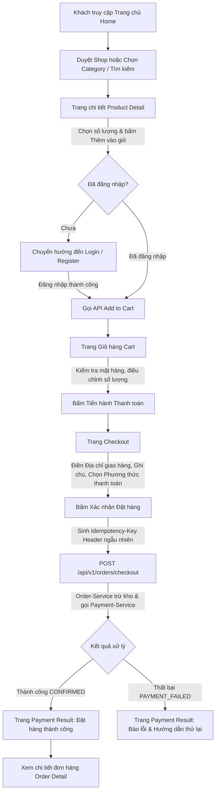
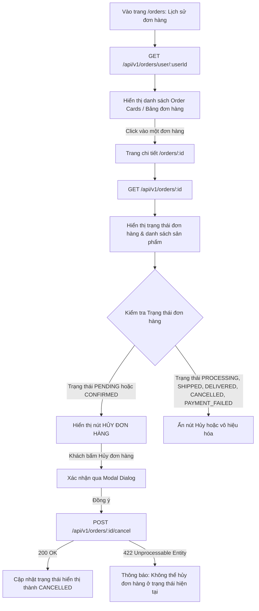
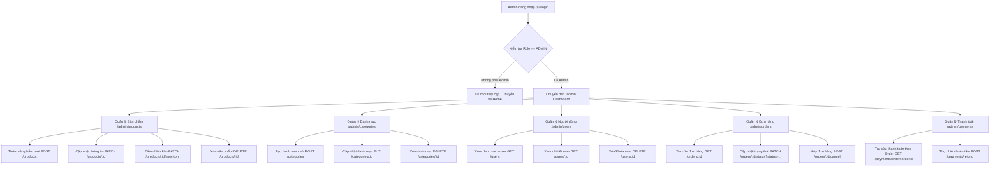

# TechGear Frontend Planning

> **Mã tài liệu:** FE-01-CATALOG-SITEMAP-FLOW  
> **Phiên bản:** 1.0.0  
> **Dự án:** Observable Microservices E-Commerce  
> **Concept:** TECHGEAR — Premium Tech Gear Store  
> **Trạng thái Backend:** FROZEN (Hoàn tất & đã audit — 5 services: API Gateway, User, Product, Order, Payment)  
> **Nguyên tắc:** Strict YAGNI — No Bloat — Source of Truth: Backend APIs

---

## 1. Product Catalog

TechGear định vị là chuỗi cửa hàng phụ kiện và thiết bị công nghệ cao cấp (Premium Tech Gear).  
Catalog gồm đúng **24 sản phẩm mẫu** (phù hợp khoảng 20–30), phân bổ đều trong **6 danh mục chuẩn** của backend.  
Giá niêm yết bằng Việt Nam Đồng (VND), SKU độc lập và unique, tồn kho (stock) thực tế, không có biến thể đa tầng (variants) do backend hiện tại lưu trữ sản phẩm phẳng (`ProductDto`).

### 1.1 Danh mục chuẩn (6 Categories)

| Category ID | Tên danh mục | Slug / Code | Mô tả |
| :---: | :--- | :--- | :--- |
| **1** | Audio | `audio` | Tai nghe hi-res, tai nghe chống ồn, microphone thu âm chuyên nghiệp. |
| **2** | Keyboards & Mouse | `keyboards-mouse` | Bàn phím cơ cơ khí cao cấp, chuột công thái học, phím custom. |
| **3** | Gaming | `gaming` | Thiết bị chơi game chuyên nghiệp: chuột esports, phím gaming, tay cầm. |
| **4** | Accessories | `accessories` | Củ sạc nhanh GaN, dock sạc đa năng, đèn màn hình bảo vệ mắt, hub sạc. |
| **5** | Monitors | `monitors` | Màn hình đồ hoạ chuẩn màu, màn hình tần số quét cao 2K/4K. |
| **6** | Laptop Accessories | `laptop-accessories` | Giá đỡ laptop nhôm công thái học, hub chuyển đổi đa cổng, túi chống sốc. |

---

### 1.2 Bảng Catalog 24 sản phẩm mẫu

| # | Tên sản phẩm | SKU | Danh mục | Giá (VND) | Tồn kho | Mô tả ngắn | Hình ảnh tham chiếu |
| :---: | :--- | :--- | :--- | :---: | :---: | :--- | :--- |
| **1** | Sony WH-1000XM5 Wireless Headphones | `TG-AUD-001` | Audio | 7.990.000 | 35 | Tai nghe không dây chống ồn chủ động đỉnh cao, bộ xử lý V1 + QN1, thời lượng pin 30 giờ. | `/assets/products/tg-aud-001.webp` |
| **2** | Bose QuietComfort Ultra Earbuds | `TG-AUD-002` | Audio | 6.490.000 | 40 | Tai nghe True Wireless khử tiếng ồn vượt trội kết hợp công nghệ âm thanh không gian Immersive Audio. | `/assets/products/tg-aud-002.webp` |
| **3** | Audio-Technica ATH-M50x Studio Monitor | `TG-AUD-003` | Audio | 3.890.000 | 50 | Tai nghe kiểm âm phòng thu huyền thoại, củ loa 45mm Neodymium, dải âm phẳng trung thực. | `/assets/products/tg-aud-003.webp` |
| **4** | Shure MV7 USB/XLR Podcast Microphone | `TG-AUD-004` | Audio | 6.250.000 | 25 | Micro thu âm dynamic chuyên nghiệp chuẩn phòng thu với kết nối kép USB và XLR linh hoạt. | `/assets/products/tg-aud-004.webp` |
| **5** | Keychron Q1 Pro Custom Mechanical Keyboard | `TG-KBM-001` | Keyboards & Mouse | 4.490.000 | 30 | Bàn phím cơ full nhôm CNC layout 75%, kết nối Bluetooth 5.1 & Type-C, Red Switch, QMK/VIA. | `/assets/products/tg-kbm-001.webp` |
| **6** | Logitech MX Master 3S Wireless Mouse | `TG-KBM-002` | Keyboards & Mouse | 2.190.000 | 65 | Chuột công thái học cao cấp, cảm biến 8000 DPI Darkfield, con lăn điện từ MagSpeed cực êm. | `/assets/products/tg-kbm-002.webp` |
| **7** | NuPhy Air75 V2 Ultra-Slim Mechanical | `TG-KBM-003` | Keyboards & Mouse | 2.890.000 | 45 | Bàn phím cơ siêu mỏng low-profile layout 75%, 3 chế độ kết nối (2.4G/BT/Cable), Cowberry Switch. | `/assets/products/tg-kbm-003.webp` |
| **8** | Logitech Lift Vertical Ergonomic Mouse | `TG-KBM-004` | Keyboards & Mouse | 1.490.000 | 50 | Chuột đứng công thái học góc 57 độ giảm áp lực cổ tay, phím bấm chống ồn SmartWheel. | `/assets/products/tg-kbm-004.webp` |
| **9** | Razer DeathAdder V3 Pro Wireless Mouse | `TG-GAM-001` | Gaming | 3.490.000 | 40 | Chuột gaming siêu nhẹ 63g chuẩn esports, cảm biến Focus Pro 30K Optical, switch quang Gen-3. | `/assets/products/tg-gam-001.webp` |
| **10** | SteelSeries Apex Pro TKL Mechanical | `TG-GAM-002` | Gaming | 4.990.000 | 20 | Bàn phím gaming switch cơ Hall Effect OmniPoint 2.0 tùy chỉnh điểm nhận lực 0.2mm - 3.8mm, màn OLED. | `/assets/products/tg-gam-002.webp` |
| **11** | HyperX Cloud III Wireless Gaming Headset | `TG-GAM-003` | Gaming | 3.290.000 | 35 | Tai nghe chơi game không dây 2.4GHz không độ trễ, driver 53mm góc nghiêng, pin bền bỉ 120 giờ. | `/assets/products/tg-gam-003.webp` |
| **12** | Xbox Wireless Controller - Carbon Black | `TG-GAM-004` | Gaming | 1.590.000 | 55 | Tay cầm chơi game thế hệ mới, phím điều hướng lai D-pad chuẩn xác, bề mặt nhám chống trượt. | `/assets/products/tg-gam-004.webp` |
| **13** | Anker 737 GaNPrime 140W Power Bank | `TG-ACC-001` | Accessories | 2.850.000 | 45 | Pin sạc dự phòng 24.000mAh hỗ trợ PD 3.1 công suất 140W sạc được laptop, màn hình thông minh. | `/assets/products/tg-acc-001.webp` |
| **14** | BenQ ScreenBar Halo LED Monitor Light | `TG-ACC-002` | Accessories | 3.990.000 | 30 | Đèn treo màn hình chống lóa mắt, đèn hắt tường ambient phía sau, điều khiển cảm ứng không dây. | `/assets/products/tg-acc-002.webp` |
| **15** | CalDigit TS4 Thunderbolt 4 Dock 18 Ports | `TG-ACC-003` | Accessories | 9.490.000 | 15 | Trạm kết nối Thunderbolt 4 hàng đầu thị trường, 18 cổng kết nối, cấp nguồn sạc 98W cho laptop. | `/assets/products/tg-acc-003.webp` |
| **16** | Belkin BoostCharge Pro 3-in-1 MagSafe 15W | `TG-ACC-004` | Accessories | 3.290.000 | 40 | Đế sạc không dây 3 trong 1 chuẩn Apple MagSafe 15W cho iPhone, Apple Watch và AirPods. | `/assets/products/tg-acc-004.webp` |
| **17** | Dell UltraSharp U2724D 27" 2K 120Hz IPS | `TG-MON-001` | Monitors | 11.490.000 | 20 | Màn hình đồ hoạ cao cấp 27 inch QHD, tấm nền IPS Black tương phản 2000:1, chuẩn màu 98% DCI-P3. | `/assets/products/tg-mon-001.webp` |
| **18** | LG UltraGear 34GN850-B 34" Curved QHD | `TG-MON-002` | Monitors | 16.900.000 | 15 | Màn hình cong siêu rộng UltraWide QHD Nano IPS, 160Hz OC, phản hồi 1ms GtG, HDR400. | `/assets/products/tg-mon-002.webp` |
| **19** | ASUS ProArt PA278CV 27" 2K sRGB 100% | `TG-MON-003` | Monitors | 8.990.000 | 25 | Màn hình chuyên thiết kế đồ họa Calman Verified, độ lệch màu Delta E < 2, cổng kết nối Type-C 65W. | `/assets/products/tg-mon-003.webp` |
| **20** | Samsung Odyssey G7 28" 4K UHD 144Hz | `TG-MON-004` | Monitors | 14.500.000 | 18 | Màn hình chơi game 4K UHD IPS phẳng, 144Hz, 1ms, hỗ trợ HDMI 2.1 cho Console và PC. | `/assets/products/tg-mon-004.webp` |
| **21** | Roost V3 Ultra-Portable Laptop Stand | `TG-LPA-001` | Laptop Accessories | 1.490.000 | 60 | Giá đỡ laptop di động siêu nhẹ có thể gập gọn, 7 mức nâng hạ góc nhìn chống đau mỏi vai gáy. | `/assets/products/tg-lpa-001.webp` |
| **22** | Satechi Aluminum Multi-Port USB-C Hub 8-in-1 | `TG-LPA-002` | Laptop Accessories | 1.890.000 | 50 | Hub chuyển đổi nhôm nguyên khối cho laptop: HDMI 4K 60Hz, Gigabit Ethernet, SD card, sạc PD. | `/assets/products/tg-lpa-002.webp` |
| **23** | Tomtoc Defender-A13 360 Laptop Sleeve | `TG-LPA-003` | Laptop Accessories | 790.000 | 80 | Túi chống sốc công nghệ CornerArmor bảo vệ 360 độ góc máy, vải kháng nước tái chế cao cấp. | `/assets/products/tg-lpa-003.webp` |
| **24** | Baseus Blade 100W Slim Power Bank 20000mAh | `TG-LPA-004` | Laptop Accessories | 1.350.000 | 40 | Pin sạc dự phòng thiết kế siêu mỏng bỏ vừa balo laptop, công suất sạc nhanh 100W 2 cổng Type-C. | `/assets/products/tg-lpa-004.webp` |

---

## 2. Sitemap

Cây sitemap được thiết kế tối giản, bám sát các endpoint thực tế của 5 microservices backend. Phân chia rõ ràng giữa phân hệ **Customer (Khách hàng)** và **Admin (Quản trị viên)**.

```
TECHGEAR STORE SITEMAP
├── CUSTOMER (Public / Authenticated User)
│   ├── /                                   [Home Page]
│   ├── /products                           [Shop / All Products]
│   ├── /categories/:id                     [Category Products Listing]
│   ├── /products/:id                       [Product Detail]
│   ├── /search                             [Search Results Page]
│   ├── /cart                               [Shopping Cart]
│   ├── /checkout                           [Checkout & Shipping Details]
│   ├── /payment/result                     [Payment & Order Creation Result]
│   ├── /orders                             [My Orders - Order History]
│   ├── /orders/:id                         [Order Detail & Tracking]
│   ├── /profile                            [User Profile & Edit]
│   ├── /login                              [User Login]
│   └── /register                           [User Registration]
│
└── ADMIN (Requires Role: ADMIN)
    ├── /admin                              [Admin Dashboard Overview]
    ├── /admin/products                     [Admin Products Management]
    ├── /admin/categories                   [Admin Categories Management]
    ├── /admin/users                        [Admin Users Management]
    ├── /admin/orders                       [Admin Orders Overview & Tracking]
    └── /admin/payments                     [Admin Payments Lookup & Refund]
```

### 2.1 Chi tiết các trang Customer

1. **Home (`/`)**: Banner hero giới thiệu TechGear, danh sách 6 categories tròn/card nổi bật, khối sản phẩm mới nhất (`size=8`, sắp xếp theo `createdAt`).
2. **Shop / Products (`/products`)**: Trang danh sách toàn bộ sản phẩm dạng lưới, có phân trang (pagination) và sắp xếp (sort: giá tăng/giảm, mới nhất).
3. **Category (`/categories/:id`)**: Trang sản phẩm theo danh mục tương ứng (ID từ 1 đến 6).
4. **Product Detail (`/products/:id`)**: Chi tiết cấu hình, hình ảnh, giá, trạng thái tồn kho (in-stock / out-of-stock), nút thêm vào giỏ hàng ("Add to Cart") với bộ chọn số lượng.
5. **Search (`/search?keyword=...`)**: Kết quả tìm kiếm sản phẩm theo từ khóa sử dụng PostgreSQL Full-Text Search của backend.
6. **Cart (`/cart`)**: Danh sách các mặt hàng đang có trong giỏ hàng, cập nhật số lượng từng item, xóa item, nút xóa toàn bộ giỏ, tổng tiền, nút chuyển sang Checkout.
7. **Checkout (`/checkout`)**: Nhập địa chỉ giao hàng (`shippingAddress`), chọn 1 trong 5 hình thức thanh toán (`paymentMethod`), nhập ghi chú (`notes`), tóm tắt đơn hàng và bấm "Đặt hàng".
8. **Payment Result (`/payment/result`)**: Hiển thị kết quả thanh toán từ checkout response (`CONFIRMED`, `PAYMENT_FAILED`, mã đơn hàng `orderId`, mã giao dịch).
9. **My Orders (`/orders`)**: Danh sách đơn hàng đã mua của tài khoản hiện tại kèm trạng thái và thời gian.
10. **Order Detail (`/orders/:id`)**: Thông tin chi tiết một đơn hàng, danh sách sản phẩm, địa chỉ giao hàng, phương thức thanh toán, nút "Hủy đơn hàng" (nếu đơn còn ở trạng thái PENDING hoặc CONFIRMED).
11. **Profile (`/profile`)**: Xem thông tin cá nhân (họ tên, email, số điện thoại) và form chỉnh sửa thông tin.
12. **Login (`/login`)**: Form đăng nhập email + mật khẩu, lưu JWT token.
13. **Register (`/register`)**: Form tạo tài khoản mới (họ tên, email, mật khẩu, số điện thoại).

### 2.2 Chi tiết các trang Admin

1. **Admin Dashboard (`/admin`)**: Thống kê số lượng catalog, quick links quản trị danh mục, sản phẩm, người dùng.
2. **Admin Products (`/admin/products`)**: Bảng quản lý sản phẩm, nút thêm sản phẩm mới (`POST /products`), nút sửa thông tin (`PATCH /products/{id}`), điều chỉnh tồn kho (`PATCH /products/{id}/inventory`), nút xóa (`DELETE /products/{id}`).
3. **Admin Categories (`/admin/categories`)**: Danh sách danh mục, tạo danh mục mới (`POST /categories`), cập nhật danh mục (`PUT /categories/{id}`), xóa danh mục (`DELETE /categories/{id}`).
4. **Admin Users (`/admin/users`)**: Bảng danh sách toàn bộ người dùng hệ thống (`GET /users`), xem chi tiết (`GET /users/{id}`), khóa/xóa tài khoản (`DELETE /users/{id}`).
5. **Admin Orders (`/admin/orders`)**: Tra cứu chi tiết đơn hàng theo `orderId`, đổi trạng thái đơn hàng (`PATCH /orders/{id}/status`), hủy đơn hàng (`POST /orders/{id}/cancel`).
6. **Admin Payments (`/admin/payments`)**: Tra cứu thanh toán theo `paymentId` hoặc `orderId`, thực hiện hoàn tiền giao dịch (`POST /payments/refund`).

---

## 3. Customer User Flow

Flow mua hàng chính từ lúc duyệt sản phẩm đến khi nhận xác nhận đơn hàng thành công:



### Các bước chi tiết trong Customer Flow:
1. **Duyệt hàng**: Khách hàng xem sản phẩm tại Home, chuyển sang `/products` hoặc lọc theo danh mục `/categories/:id` hoặc tìm từ khóa tại `/search`.
2. **Chọn sản phẩm**: Khách click vào card sản phẩm xem chi tiết `/products/:id`, kiểm tra thông số kỹ thuật, giá cả, và lượng tồn kho khả dụng.
3. **Thêm vào giỏ (Add to Cart)**: Khách chọn số lượng (1 đến tối đa tồn kho) và bấm "Thêm vào giỏ". Cart yêu cầu JWT Token (OrderPrincipal) nên nếu chưa login, hệ thống prompt chuyển sang trang `/login`.
4. **Xem giỏ hàng (Cart)**: Tại `/cart`, khách hàng có thể tăng/giảm số lượng (`PATCH /cart/items/{itemId}`) hoặc xóa item (`DELETE /cart/items/{itemId}`).
5. **Thanh toán (Checkout)**: Khách ấn "Đặt hàng" để vào `/checkout`. Nhập thông tin bắt buộc:
   - `shippingAddress`: Địa chỉ nhận hàng (từ 10 đến 500 ký tự).
   - `paymentMethod`: 1 trong 5 hình thức: `CREDIT_CARD`, `DEBIT_CARD`, `UPI`, `NET_BANKING`, `WALLET`.
   - `notes`: Ghi chú giao hàng (tùy chọn, tối đa 500 ký tự).
6. **Thực thi Checkout**: Frontend tự động sinh một chuỗi UUID duy nhất gán vào header `Idempotency-Key` (chống double charge khi bấm nhiều lần), sau đó gửi request tới backend.
7. **Kết quả thanh toán (Payment Result)**:
   - Nếu thanh toán thành công: Giỏ hàng được xóa tự động, trạng thái order là `CONFIRMED`, hiển thị mã `orderId` và chuyển sang `/orders/:id`.
   - Nếu thanh toán thất bại: Báo lỗi chi tiết (ví dụ: thẻ không đủ tiền, lỗi cổng thanh toán), giữ nguyên giỏ hàng để khách thử lại phương thức khác.

---

## 4. Authentication Flow

Flow xác thực tài khoản sử dụng JWT Token (không có refresh token, không có OAuth2):

```mermaid
flowchart TD
    subgraph Đăng ký (Register)
        R1[Vào trang /register] --> R2[Nhập Họ, Tên, Email, SĐT, Mật khẩu]
        R2 --> R3[POST /api/v1/auth/register]
        R3 -->|201 Created| R4[Nhận JWT accessToken & UserProfile]
        R4 --> R5[Lưu token vào LocalStorage/Cookie]
        R5 --> R6[Tự động đăng nhập & chuyển sang Trang chủ hoặc Profile]
    end

    subgraph Đăng nhập (Login)
        L1[Vào trang /login] --> L2[Nhập Email & Mật khẩu]
        L2 --> L3[POST /api/v1/auth/login]
        L3 -->|200 OK| L4[Nhận JWT accessToken & UserProfile]
        L4 --> L5[Lưu token vào LocalStorage/Cookie]
        L5 --> L6{Kiểm tra Role}
        L6 -->|Role: ADMIN| L7[Chuyển hướng sang /admin Dashboard]
        L6 -->|Role: USER| L8[Chuyển hướng về trang trước đó hoặc /products]
    end

    subgraph Xem & Cập nhật Hồ sơ (Profile)
        P1[Vào trang /profile] --> P2[Gửi GET /api/v1/users/me kèm Bearer Token]
        P2 --> P3[Hiển thị thông tin cá nhân]
        P3 --> P4[Chỉnh sửa Tên, SĐT & Gửi PATCH /api/v1/users/me]
        P4 --> P5[Cập nhật UI thành công]
    end

    subgraph Đăng xuất (Logout)
        O1[Bấm Đăng xuất] --> O2[Xóa accessToken khỏi LocalStorage/Cookie]
        O2 --> O3[Xóa State người dùng trong Frontend Store]
        O3 --> O4[Chuyển hướng về /login]
    end
```

---

## 5. Order Flow

Flow quản lý vòng đời đơn hàng phía Customer, bao gồm nghiệp vụ hủy đơn theo đúng quy tắc ràng buộc trạng thái của backend:



> **Quy tắc nghiệp vụ cốt lõi từ backend (`OrderService.java`):**  
> Khách hàng chỉ có thể hủy đơn hàng khi trạng thái là `PENDING` hoặc `CONFIRMED`. Nếu đơn đã sang `PROCESSING`, `SHIPPED`, `DELIVERED`, `CANCELLED` hoặc `PAYMENT_FAILED`, backend sẽ trả mã lỗi HTTP `422 Unprocessable Entity` ("Cannot cancel order in status: ..."). Frontend kiểm tra điều kiện này để ẩn/hiện nút Hủy tương ứng.

---

## 6. Admin Flow

Flow đăng nhập và điều hành dành cho Quản trị viên (Admin):



---

## 7. API Mapping

Bảng đối chiếu toàn bộ các trang và chức năng của Frontend với các REST API backend hiện hữu qua API Gateway (`http://localhost:8080`).

### 7.1 Phân hệ Customer

| Trang Frontend | Hành động người dùng | Backend Endpoint | Method | Header bắt buộc | Ghi chú & Ràng buộc |
| :--- | :--- | :--- | :---: | :--- | :--- |
| **Home (`/`)** | Tải danh mục nổi bật | `/api/v1/categories` | `GET` | Không | Lấy toàn bộ danh mục hoạt động (`active: true`). |
| | Tải sản phẩm mới nhất | `/api/v1/products?page=0&size=8&sort=createdAt,desc` | `GET` | Không | Phân trang Spring Pageable. |
| **Shop (`/products`)** | Lấy danh sách sản phẩm | `/api/v1/products` | `GET` | Không | Query params: `page`, `size`, `sort`. |
| **Category (`/categories/:id`)** | Lấy thông tin danh mục | `/api/v1/categories/{id}` | `GET` | Không | Chi tiết danh mục. |
| | Lấy sản phẩm theo danh mục | `/api/v1/products/category/{categoryId}` | `GET` | Không | Query params: `page`, `size`. |
| **Product Detail (`/products/:id`)** | Lấy chi tiết sản phẩm | `/api/v1/products/{id}` | `GET` | Không | Trả về `ProductDto` (giá, tồn kho, ảnh, mô tả). |
| | Thêm vào giỏ hàng | `/api/v1/cart/items` | `POST` | `Authorization: Bearer <token>` | Body: `{"productId": 1, "quantity": 2}`. |
| **Search (`/search`)** | Tìm kiếm sản phẩm | `/api/v1/products/search` | `GET` | Không | Query param: `keyword`, `page`, `size`. Dùng PostgreSQL Full-text search. |
| **Cart (`/cart`)** | Lấy thông tin giỏ hàng | `/api/v1/cart` | `GET` | `Authorization: Bearer <token>` | Trả về `CartDto` (danh sách item, `totalPrice`, `itemCount`). |
| | Đổi số lượng món hàng | `/api/v1/cart/items/{itemId}` | `PATCH` | `Authorization: Bearer <token>` | Body: `{"quantity": 3}` (1 đến tối đa cho phép). |
| | Xóa 1 món hàng | `/api/v1/cart/items/{itemId}` | `DELETE` | `Authorization: Bearer <token>` | Xóa item khỏi cart. |
| | Xóa toàn bộ giỏ hàng | `/api/v1/cart` | `DELETE` | `Authorization: Bearer <token>` | Làm rỗng giỏ hàng. |
| **Checkout (`/checkout`)** | Đặt hàng & thanh toán | `/api/v1/orders/checkout` | `POST` | `Authorization: Bearer <token>`<br>`Idempotency-Key: <uuid>` | Body: `shippingAddress`, `paymentMethod`, `notes`. Tự động gọi Payment Service & xóa cart. |
| **Payment Result (`/payment/result`)** | Xem kết quả vừa checkout | Dữ liệu trả về trực tiếp từ checkout | — | — | Response có `orderId`, `status`, `totalAmount`. |
| | Tra cứu chi tiết giao dịch | `/api/v1/payments/order/{orderId}` | `GET` | `Authorization: Bearer <token>` | Lấy danh sách giao dịch của đơn hàng. |
| **My Orders (`/orders`)** | Xem danh sách đơn hàng | `/api/v1/orders/user/{userId}` | `GET` | `Authorization: Bearer <token>` | Phân trang: `page`, `size`, `sort=createdAt,desc`. |
| **Order Detail (`/orders/:id`)** | Xem chi tiết 1 đơn hàng | `/api/v1/orders/{id}` | `GET` | `Authorization: Bearer <token>` | Trả về thông tin đầy đủ và danh sách items. |
| | Hủy đơn hàng | `/api/v1/orders/{id}/cancel` | `POST` | `Authorization: Bearer <token>` | Chỉ hợp lệ khi status là `PENDING` hoặc `CONFIRMED`. |
| **Profile (`/profile`)** | Lấy thông tin cá nhân | `/api/v1/users/me` | `GET` | `Authorization: Bearer <token>` | Lấy họ tên, email, phone, role. |
| | Cập nhật hồ sơ | `/api/v1/users/me` | `PATCH` | `Authorization: Bearer <token>` | Body: `firstName`, `lastName`, `phone`. |
| **Login (`/login`)** | Đăng nhập tài khoản | `/api/v1/auth/login` | `POST` | Không | Body: `email`, `password`. Trả về `accessToken` và `user`. |
| **Register (`/register`)** | Đăng ký tài khoản | `/api/v1/auth/register` | `POST` | Không | Body: `firstName`, `lastName`, `email`, `password`, `phone`. Trả về `accessToken` và `user`. |

---

### 7.2 Phân hệ Admin

| Trang Frontend Admin | Hành động | Backend Endpoint | Method | Quyền / Header | Trạng thái API & Ghi chú |
| :--- | :--- | :--- | :---: | :--- | :--- |
| **Dashboard (`/admin`)** | Thống kê số lượng tổng quan | *Nhiều API kết hợp* | `GET` | `ROLE_ADMIN` | **Backend chưa có API hỗ trợ aggregate stats riêng** (chẳng hạn `/admin/dashboard-stats`). Frontend tính toán tổng số từ `GET /api/v1/products` và `GET /api/v1/users` hoặc hiển thị metric cards cơ bản. |
| **Products (`/admin/products`)** | Danh sách sản phẩm | `/api/v1/products` | `GET` | `ROLE_ADMIN` | Đã có sẵn (hỗ trợ phân trang). |
| | Tạo mới sản phẩm | `/api/v1/products` | `POST` | `ROLE_ADMIN` | Body: `name`, `sku`, `price`, `stockQuantity`, `categoryId`, `description`, `imageUrl`. |
| | Cập nhật thông tin | `/api/v1/products/{id}` | `PATCH` | `ROLE_ADMIN` | Body: `UpdateProductRequest`. |
| | Cập nhật tồn kho nhanh | `/api/v1/products/{id}/inventory` | `PATCH` | `ROLE_ADMIN` | Body: `{"quantity": 10, "operation": "ADD"}` (`ADD`, `SUBTRACT`, `SET`). |
| | Xóa sản phẩm | `/api/v1/products/{id}` | `DELETE` | `ROLE_ADMIN` | Xóa sản phẩm khỏi database. |
| **Categories (`/admin/categories`)**| Danh sách danh mục | `/api/v1/categories` | `GET` | `ROLE_ADMIN` | Đã có sẵn. |
| | Tạo mới danh mục | `/api/v1/categories` | `POST` | `ROLE_ADMIN` | Body: `name`, `description`, `imageUrl`. |
| | Cập nhật danh mục | `/api/v1/categories/{id}` | `PUT` | `ROLE_ADMIN` | Body: `CreateCategoryRequest`. |
| | Xóa danh mục | `/api/v1/categories/{id}` | `DELETE` | `ROLE_ADMIN` | Xóa danh mục. |
| **Users (`/admin/users`)** | Danh sách người dùng | `/api/v1/users` | `GET` | `ROLE_ADMIN` | Trả về `List<UserProfileDto>`. |
| | Xem chi tiết 1 người dùng | `/api/v1/users/{id}` | `GET` | `ROLE_ADMIN` | Xem thông tin chi tiết một user theo ID. |
| | Xóa người dùng | `/api/v1/users/{id}` | `DELETE` | `ROLE_ADMIN` | Xóa tài khoản người dùng khỏi hệ thống. |
| **Orders (`/admin/orders`)** | Danh sách toàn bộ đơn hàng | — | — | — | **Backend chưa có API hỗ trợ GET /api/v1/orders không điều kiện**. Backend hiện chỉ có `GET /api/v1/orders/user/{userId}` và `GET /api/v1/orders/{id}`. Frontend Admin cung cấp ô tra cứu theo `orderId` hoặc theo `userId`. **Không sửa backend**. |
| | Xem chi tiết đơn hàng | `/api/v1/orders/{id}` | `GET` | `ROLE_ADMIN` | Admin được quyền xem bất kỳ đơn hàng nào theo ID. |
| | Cập nhật trạng thái đơn | `/api/v1/orders/{id}/status` | `PATCH` | `ROLE_ADMIN` | Query param: `status` (`CONFIRMED`, `PROCESSING`, `SHIPPED`, `DELIVERED`, `CANCELLED`, `REFUNDED`). |
| | Hủy đơn hàng | `/api/v1/orders/{id}/cancel` | `POST` | `ROLE_ADMIN` | Admin có quyền hủy đơn (nếu status là PENDING/CONFIRMED). |
| **Payments (`/admin/payments`)** | Danh sách toàn bộ thanh toán | — | — | — | **Backend chưa có API hỗ trợ GET /api/v1/payments không điều kiện**. Backend chỉ có `GET /api/v1/payments/{id}`, `GET /api/v1/payments/order/{orderId}` và `GET /api/v1/payments/user/{userId}`. Frontend Admin tra cứu theo `orderId` hoặc `paymentId`. **Không sửa backend**. |
| | Xem thanh toán theo đơn | `/api/v1/payments/order/{orderId}` | `GET` | `ROLE_ADMIN` | Xem danh sách các lần charge/refund của đơn hàng. |
| | Xem chi tiết giao dịch | `/api/v1/payments/{id}` | `GET` | `ROLE_ADMIN` | Lấy chi tiết payment theo ID. |
| | Thực hiện hoàn tiền | `/api/v1/payments/refund` | `POST` | `ROLE_ADMIN` | Body: `{"paymentId": 1, "orderId": 1, "amount": 100000, "reason": "Customer cancellation"}`. |

---

## 8. Scope Boundary

Nhằm tuân thủ tuyệt đối quy tắc **STRICT YAGNI**, dự án TechGear phân định ranh giới chức năng rõ ràng. Tất cả các tính năng dưới đây **KHÔNG** thuộc phạm vi của Frontend lẫn Backend ở giai đoạn hiện tại:

### 8.1 Danh sách các tính năng TUYỆT ĐỐI KHÔNG triển khai (Out of Scope)

1. **Không có Wishlist (Sản phẩm yêu thích)**: Backend không có bảng/endpoint lưu wishlist. Không thêm nút trái tim hoặc trang Wishlist.
2. **Không có Reviews & Ratings (Đánh giá & Sao)**: Không có review service/endpoint. Bỏ qua hoàn toàn form đánh giá, rating sao, bình luận.
3. **Không có Coupons / Voucher / Khuyến mãi**: Backend không hỗ trợ mã giảm giá. Không làm ô nhập promo code tại giỏ hàng và checkout.
4. **Không có Flash Sale / Countdown Deals**: Không có bảng hẹn giờ giảm giá. Giá sản phẩm là giá niêm yết cố định.
5. **Không có Điểm thưởng / Loyalty Program**: Không có ví điểm hoặc hạng thành viên (Gold/Silver).
6. **Không có Gợi ý thông minh (Recommendation Engine)**: Sản phẩm hiển thị theo thứ tự phân trang tiêu chuẩn hoặc lọc danh mục.
7. **Không có Đăng ký định kỳ (Subscription)**: Không có đơn hàng lặp lại hàng tháng.
8. **Không có Tích hợp đơn vị vận chuyển thực tế**: Không tích hợp API của GHTK, GHN, Viettel Post hay Shopee Express. Địa chỉ giao hàng được lưu dưới dạng chuỗi văn bản (`shippingAddress`).
9. **Không có Inventory Warehouse Microservice**: Tồn kho được quản lý trực tiếp qua trường `stockQuantity` trong Product Service.
10. **Không có Biến thể sản phẩm đa tầng (Product Variants)**: Backend lưu mỗi sản phẩm là một bản ghi phẳng với 1 SKU duy nhất. Các lựa chọn (màu sắc, switch) nếu cần demo sẽ được phân tách thành từng sản phẩm độc lập với SKU riêng.
11. **Không có Cổng thanh toán bên thứ ba thực tế (Real Payment Gateway)**: Không tích hợp SDK Stripe, PayPal, VNPay, ZaloPay. Toàn bộ thanh toán được mô phỏng trực tiếp qua `payment-service` với 5 phương thức (`CREDIT_CARD`, `DEBIT_CARD`, `UPI`, `NET_BANKING`, `WALLET`).
12. **Không có OAuth2 / Social Login**: Không làm nút đăng nhập Google, Facebook, Apple. Chỉ dùng email và mật khẩu nội bộ.
13. **Không có Refresh Token / Token Rotation**: Backend chỉ cấp 1 `accessToken` JWT duy nhất có thời hạn 24 giờ.
14. **Không có Microservice Thông báo độc lập (Notification Service)**: Không gửi email thật, không gửi SMS hay Web Push.
15. **Không có Chatbot / Live Support**: Không tích hợp widget trò chuyện khách hàng.
16. **Không tự ý sửa đổi Backend hay Redesign API**: Backend đã hoàn tất và đóng băng. Bất kỳ sự thiếu hụt nào (như thiếu API list all orders cho admin) được giải quyết bằng cách thiết kế UI tra cứu theo ID thay vì can thiệp sửa mã nguồn backend.

---

> **Kết luận kế hoạch FE-01**: Bản tài liệu này xác lập toàn bộ dữ liệu mẫu, cấu trúc điều hướng, luồng người dùng và ma trận API mapping của TechGear, tạo tiền đề vững chắc cho việc thiết kế giao diện Frontend mà không làm phình phạm vi dự án.
