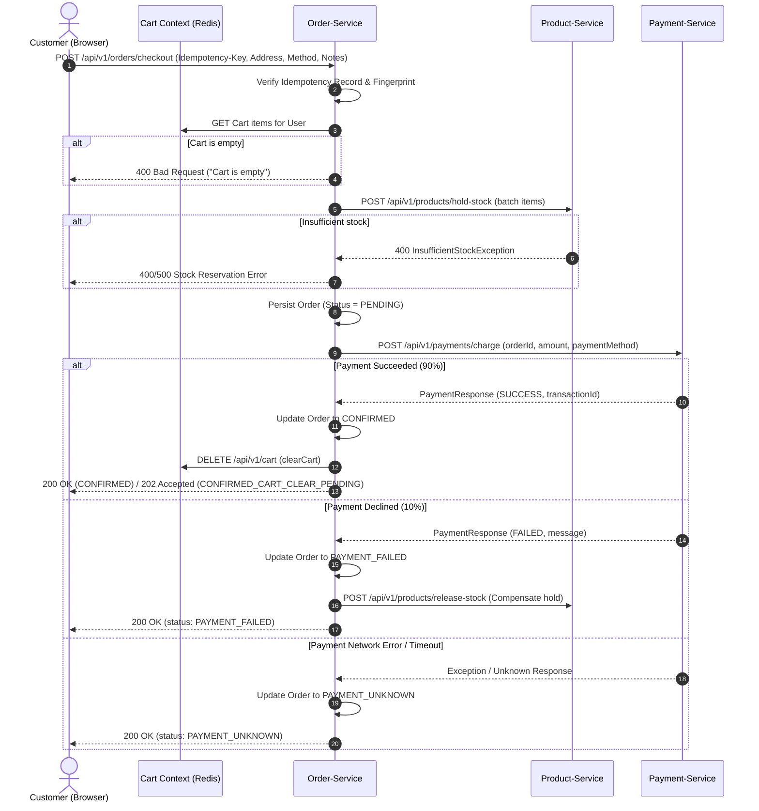

# TECHGEAR — Checkout Design Specification

> **Document ID:** FE-06-CHECKOUT-DESIGN  
> **Route:** `/checkout`  
> **Version:** 1.0.1  
> **Screen:** Customer Checkout  
> **Visual Reference:** Stitch Project (`projectId: 113306237264437644`, `screenId: bcddf14755ca40c5afc6334bea3ad158`)  
> **Design System:** Obsidian & Paper (`assets/592f25a1d5524b0091e02d25cfc6dd89`)  
> **Backend Verification:** Spring Boot 3.2 `order-service` (`OrderController`, `OrderService`, `CheckoutRequest`, `OrderIdempotencyService`) & `payment-service` (`PaymentController`, `PaymentService`, `PaymentResponse`) Verified  
> **Skills Applied:** `ui-ux-pro-max` (UX hierarchy & interaction architecture) & `design-taste-frontend` (anti-slop restraint & typographic discipline)  
> **Status:** READY FOR REVIEW

---

## 1. Purpose & User Goal

*   **Purpose:** The Checkout screen is the final commitment stage of the TECHGEAR customer purchasing journey. It collects physical delivery destination details, payment instrument selection, and order delivery instructions, before executing an atomic, idempotent checkout operation across `order-service`, `product-service` (stock hold), and `payment-service` (payment charge).
*   **User Goal:**
    1.  *Confirm delivery destination:* Enter a valid shipping address within Vietnam or international dispatch.
    2.  *Select payment method:* Choose one of 5 supported payment channels (`CREDIT_CARD`, `DEBIT_CARD`, `UPI`, `NET_BANKING`, `WALLET`).
    3.  *Review cart contents:* Visually verify purchased items, quantities, and line subtotals without leaving the checkout screen.
    4.  *Verify exact financial commitment:* Inspect confirmed Subtotal and Total in VND with zero fabricated tax or shipping surcharges.
    5.  *Execute order placement:* Trigger the primary conversion action with immediate loading feedback and idempotent replay protection.

---

## 2. Route & Placement in User Flow

*   **Standard Route:** `/checkout` (Requires authenticated customer session via JWT Bearer token).
*   **Upstream Flow:** 
    ```
    Home (FE-02) 
      → Shop (FE-03) 
      → Product Detail (FE-04) 
      → Cart (FE-05 Canonical: c166b83c090d4ced8b1a243104b6f9e3) 
      → CHECKOUT (FE-06: /checkout)
    ```
*   **Downstream Flow:**
    *   *Success (`CONFIRMED` / `CONFIRMED_CART_CLEAR_PENDING`):* Both statuses represent a successful checkout and provide `orderId`. Frontend proceeds directly to Order Detail (`/orders/{orderId}`) or Payment Result confirmation (`/payment/result?orderId={orderId}`).
    *   *Payment Failure (`PAYMENT_FAILED`):* Displays clear customer-facing notification: *"Payment failed. Your order was not completed."* (Held stock is automatically released; no dedicated retry API).
    *   *Payment Indeterminate (`PAYMENT_UNKNOWN`):* Displays neutral advisory notification with Order ID advising customer to check Order History (`/orders`) before attempting duplicate payments.
    *   *Empty Cart Guard:* If customer accesses `/checkout` with 0 cart items, system redirects immediately to `/cart` (`Empty checkout → /cart`).

---

## 3. Backend API Audit & Verification

All UI structures, input fields, action buttons, and status states map strictly to the active Spring Boot 3.2 backend source code in `order-service` and `payment-service`.

### 3.1 Checkout Endpoint Specification

| Attribute | Specification |
| :--- | :--- |
| **HTTP Method** | `POST` |
| **Path** | `/api/v1/orders/checkout` |
| **Authentication** | Required — Bearer JWT in `Authorization` header (`OrderSecurityConfig.java:47`) |
| **Mandatory Headers** | `Idempotency-Key`: UUIDv4 string (min 1, max 128 characters, non-blank) |
| **Request Payload** | JSON mapping directly to `com.ecommerce.orderservice.dto.CheckoutRequest` |
| **Success Responses** | `200 OK` (Standard confirmation) or `202 ACCEPTED` (`CONFIRMED_CART_CLEAR_PENDING`) |
| **Error Responses** | `400 BAD REQUEST` (Validation error / Empty cart), `401 UNAUTHORIZED`, `409 CONFLICT` (Key payload mismatch), `500 INTERNAL SERVER ERROR` |

---

### 3.2 Actual Checkout Request Model (`CheckoutRequest.java`)

```json
{
  "shippingAddress": "123 Main Street, Suite 400, Tech Park, District 1, Ho Chi Minh City",
  "paymentMethod": "CREDIT_CARD",
  "notes": "Please leave the package at the front reception desk."
}
```

#### Field Constraints & Validation Rules:
1.  **`shippingAddress`** (`String`, Required):
    *   Validation: `@NotBlank`, `@Size(min = 10, max = 500)`, `@Pattern(regexp = "^[\\p{L}\\d\\s\\-'.&(),#]+$")`
    *   UI Behavior: Renders as a multi-line delivery textarea with character counter and live validation.
2.  **`paymentMethod`** (`PaymentMethod` enum, Required):
    *   Validation: `@NotNull`
    *   Supported Enum Constants:
        - `CREDIT_CARD` — Credit card payment channel
        - `DEBIT_CARD` — Debit card payment channel
        - `UPI` — Unified Payments Interface
        - `NET_BANKING` — Online direct bank transfer
        - `WALLET` — Digital wallet balance
    *   UI Behavior: Renders as a 5-card selectable grid with precision radio selectors.
3.  **`notes`** (`String`, Optional):
    *   Validation: `@Size(max = 500)`, `@Pattern(regexp = "^[\\p{L}\\d\\s\\-'.&(),!?;:]*$")`
    *   UI Behavior: Single-line or compact textarea for special delivery instructions.

> [!IMPORTANT]
> **Audit Finding — Unrequested Client Fields:**
> The backend `CheckoutRequest` does **NOT** accept: recipient name, phone number, billing address, postal code as separate columns, card number, CVV, expiry date, discount code, or shipping carrier selection. Recipient identity is derived from the authenticated JWT principal. The frontend must **never** render unbacked form fields.

---

### 3.3 Actual Checkout Response Structure (`OrderController.java:76-101`)

The controller returns a JSON map containing confirmed checkout metadata:

```json
{
  "authenticatedUserId": 42,
  "idempotencyKey": "9b1deb4d-3b7d-4bad-9bdd-2b0d7b3dcb6d",
  "orderId": 105,
  "status": "CONFIRMED",
  "totalAmount": 12480000.00,
  "requestFingerprint": "e3b0c44298fc1c149afbf4c8996fb92427ae41e4649b934ca495991b7852b855",
  "cartClearStatus": "CLEARED"
}
```

*   `orderId`: Generated primary key of the persisted `Order` entity.
*   `status`: Canonical order state returned by checkout orchestration (`CONFIRMED`, `CONFIRMED_CART_CLEAR_PENDING`, `PAYMENT_FAILED`, or `PAYMENT_UNKNOWN`).
*   `totalAmount`: Final confirmed aggregate price in VND calculated from actual held items.
*   `cartClearStatus`: Redis cart evacuation status (`CLEARED`, `PENDING`, or `NOT_REQUIRED`).

---

### 3.4 Actual Order & Payment Status Semantics

#### Order Statuses Relevant to Checkout (`OrderStatus.java`):
*   **`PENDING`:** Initial persisted state while stock hold is active and payment is in-flight.
*   **`CONFIRMED`:** Payment charged successfully (`PaymentResponse.STATUS_SUCCESS`), stock held, Redis cart cleared. Standard successful checkout.
*   **`CONFIRMED_CART_CLEAR_PENDING`:** Status returned with `HTTP 202 ACCEPTED` (`OrderController.java:96`). Payment succeeded and order was confirmed in the database; only the asynchronous Redis cart clear task is pending. Treated as a successful checkout by the UI. Uses `orderId` from the response to proceed directly to Order Detail (`/orders/{orderId}`).
*   **`PAYMENT_FAILED`:** Payment declined by bank (`PaymentResponse.STATUS_FAILED`). Order entity saved with failed status; stock hold is automatically compensated via `productClient.releaseStock(...)`.
*   **`PAYMENT_UNKNOWN`:** Payment client timed out, received HTTP 500, or returned unexpected status. Stock remains allocated pending manual ops reconciliation.

#### Payment Statuses in Payment Service (`PaymentStatus.java` / `PaymentResponse.java`):
*   `STATUS_SUCCESS` (`"SUCCESS"`): Simulates 90% bank approval rate. Generates a unique UUID `transactionId`.
*   `STATUS_FAILED` (`"FAILED"`): Simulates 10% bank decline rate. Message: *"Payment declined by bank. Please try again."*
*   `STATUS_UNKNOWN` (`"UNKNOWN"`): Captured when `paymentClient.chargePayment(...)` throws an unhandled exception or network timeout.

---

## 4. End-to-End Orchestration Flow



---

## 5. Visual Language & Token Architecture

The Checkout screen maintains 100% visual parity with canonical FE-05 Cart (`c166b83c090d4ced8b1a243104b6f9e3`) and the **Obsidian & Paper** design system:

*   **Canvas:** `#FAFAF9` (warm alabaster archival foundation)
*   **Surface:** `#FFFFFF` (pure spec surface for card enclosures)
*   **Milled Bays:** `#F5F5F4` (tactile neutral for thumbnail bays and active selector backgrounds)
*   **Precision Borders:** `#E7E5E4` (1px solid hairline gridlines throughout)
*   **Primary Type:** `#1C1917` (obsidian charcoal)
*   **Secondary Type:** `#57534E` (stone neutral) and `#78716C` (muted technical)
*   **Primary Conversion Accent:** `#D97706` / `#B45309` (Signal Amber — dedicated to the "PLACE ORDER" CTA)
*   **Typography:**
    *   *Plus Jakarta Sans:* Page title, section headings, form labels, radio labels, and CTA button text.
    *   *JetBrains Mono:* Tabular numbers (`tabular-nums`), prices (`4.490.000 ₫`), SKUs (`TG-KBM-001`), payment method codes, and order IDs.
*   **Geometry:** 4px control radius for inputs, textareas, and buttons; 6px container radius for structured cards. Zero-shadow architectural plan.

---

## 6. Page Structure & Desktop 2-Column Grid

Max container width is `1280px` (`max-w-7xl`), divided into a **65% Inputs & Review / 35% Sticky Summary** layout:

```
┌────────────────────────────────────────────────────────────────────────┐
│ 1. HEADER (Shared Sticky 64px Nav — TECHGEAR STORE, Cart Badge [2])    │
├────────────────────────────────────────────────────────────────────────┤
│ 2. PAGE HEADING AREA                                                   │
│    Cart → Checkout                                                     │
│    Checkout                                                            │
├────────────────────────────────────────────────────────────────────────┤
│ 3 & 4. MAIN CHECKOUT GRID (Desktop 2-Column: 65% / 35%)                │
│ ┌───────────────────────────────────────┬────────────────────────────┐ │
│ │ LEFT COLUMN (Inputs & Review ~65%)    │ RIGHT COLUMN (~35% Sticky) │ │
│ │ ┌───────────────────────────────────┐ │ ┌────────────────────────┐ │ │
│ │ │ 1. SHIPPING DESTINATION           │ │ │ Order Summary          │ │ │
│ │ │ Delivery Address *                │ │ │ Subtotal   12.480.000 ₫│ │ │
│ │ │ [Textarea: 10 - 500 chars]        │ │ │ ────────────────────── │ │ │
│ │ │ Order Notes (Optional)            │ │ │ Total      12.480.000 ₫│ │ │
│ │ │ [Input: Optional delivery notes]  │ │ │                        │ │ │
│ │ └───────────────────────────────────┘ │ │ Final order details... │ │ │
│ │ ┌───────────────────────────────────┐ │ │                        │ │ │
│ │ │ 2. PAYMENT METHOD                 │ │ │ [   PLACE ORDER   ]    │ │ │
│ │ │ [● Credit Card ] [ Debit Card   ] │ │ │                        │ │ │
│ │ │ [  UPI         ] [ Net Banking  ] │ │ │ Return to Cart         │ │ │
│ │ │ [  Digital Wallet ]               │ │ │                        │ │ │
│ │ └───────────────────────────────────┘ │ └────────────────────────┘ │ │
│ │ ┌───────────────────────────────────┐ │                            │ │
│ │ │ 3. REVIEW ITEMS (2)               │ │                            │ │
│ │ │ [Img] Keychron Q1 Pro   4.490.000₫│ │                            │ │
│ │ │ [Img] Sony WH-1000XM5   7.990.000₫│ │                            │ │
│ │ │ Edit items in Cart                │ │                            │ │
│ │ └───────────────────────────────────┘ │                            │ │
│ └───────────────────────────────────────┴────────────────────────────┘ │
├────────────────────────────────────────────────────────────────────────┤
│ 5. FOOTER (Shared Customer Blueprint: Categories, Portal, Legal)       │
└────────────────────────────────────────────────────────────────────────┘
```

---

## 7. Section-by-Section Visual & Functional Specification

### 7.1 Header (Shared Navigation Component)
*   **Dimensions:** Exact `64px` height, `sticky top-0 z-50`.
*   **Surface:** `#FAFAF9` with `backdrop-filter: blur(8px)`, bottom hairline `1px solid #E7E5E4`.
*   **Wordmark:** `TECHGEAR` with uppercase technical label `STORE` (`text-[10px]`, bordered).
*   **Contextual Status:** Cart icon displaying active item count badge `[2]`.

### 7.2 Page Heading Section
*   **Breadcrumb:** `Cart → Checkout` (JetBrains Mono `11px`, `#78716C`, uppercase tracking-wider).
*   **Main Title:** `Checkout` (Plus Jakarta Sans `32px` bold, tracking `-0.025em`, `#1C1917`).

### 7.3 Card 1: Shipping Destination (Left Column)
*   **Container:** Surface `#FFFFFF`, border `1px solid #E7E5E4`, radius `6px`, padding `p-6`.
*   **Header:** `Shipping Address` (Plus Jakarta Sans `18px` SemiBold, `#1C1917`).
*   **Subtext:** "Enter your physical delivery address in Vietnam or international dispatch." (`13px`, `#78716C`).
*   **Delivery Address Field (Required):**
    *   Label: `DELIVERY ADDRESS *` (JetBrains Mono `11px`, `#57534E`, uppercase).
    *   Control: Multi-line textarea, height `96px` (`h-24`), border `1px solid #E7E5E4`, background `#FAFAF9`, focus: `#FFFFFF` with border `#D97706`.
    *   Placeholder: `"123 Main Street, Suite 400, Tech Park, District 1, Ho Chi Minh City"`.
    *   Validation Behavior: Minimum 10 characters, maximum 500 characters. If empty or `< 10` on submit, displays inline error banner: *"Delivery address must be between 10 and 500 characters."*
*   **Order Notes Field (Optional):**
    *   Label: `ORDER NOTES (OPTIONAL)` (JetBrains Mono `11px`, `#57534E`, uppercase, mt-4).
    *   Control: Text input, height `40px`, border `1px solid #E7E5E4`, background `#FAFAF9`, focus: border `#D97706`.
    *   Placeholder: `"Special delivery instructions (e.g. Leave package with front desk)"`.
    *   Validation: Max 500 characters.

### 7.4 Card 2: Payment Method (Left Column)
*   **Container:** Surface `#FFFFFF`, border `1px solid #E7E5E4`, radius `6px`, padding `p-6`.
*   **Header:** `Payment Method` (Plus Jakarta Sans `18px` SemiBold, `#1C1917`).
*   **Subtext:** "Select a payment method for your order." (`13px`, `#78716C`, strictly factual, no security or guarantee claims).
*   **Payment Option Cards (5-Way Responsive Grid):**
    *   Grid: `grid grid-cols-2 sm:grid-cols-3 gap-3`.
    *   **Option 1:** `Credit Card` (`CREDIT_CARD`) — Selected by default.
    *   **Option 2:** `Debit Card` (`DEBIT_CARD`).
    *   **Option 3:** `UPI` (`UPI`).
    *   **Option 4:** `Net Banking` (`NET_BANKING`).
    *   **Option 5:** `Digital Wallet` (`WALLET`).
    *   **Selected State Styling:** Border `2px solid #1C1917`, background `#F5F5F4`, solid inner radio indicator in `#1C1917`.
    *   **Unselected State Styling:** Border `1px solid #E7E5E4`, background `#FFFFFF`, hover: `#FAFAF9`, hollow 1px radio circle.
*   **Design Restraint & YAGNI:** Strictly zero unconfirmed claims (no "Secure payment", "Bank verified", "Instant authorization", "Encrypted payment"). No card details form, no CVV, no expiry inputs. Free of notice boxes, leaving natural clean card padding.

### 7.5 Card 3: Order Items Review (Left Column)
*   **Container:** Surface `#FFFFFF`, border `1px solid #E7E5E4`, radius `6px`, padding `p-6`.
*   **Header Row:**
    *   Title: `Review Items (2)` (Plus Jakarta Sans `18px` SemiBold, `#1C1917`).
    *   Quick Link: `Edit items in Cart` (`href="/cart"`, Plus Jakarta Sans `12px`, text `#D97706`, hover: underline).
*   **Item Row Anatomy:**
    *   Thumbnail Bay: `64px × 64px`, background `#F5F5F4`, border `1px solid #E7E5E4`, radius `4px`, object-cover studio photo.
    *   Metadata: Product title (Plus Jakarta Sans `14px` SemiBold), SKU (JetBrains Mono `11px`, `#78716C`), Quantity indicator (`Qty: 1`).
    *   Line Subtotal: JetBrains Mono `14px` Medium, `#1C1917`, flush right (e.g. `4.490.000 ₫` and `7.990.000 ₫`).
    *   Hairline divider `1px solid #E7E5E4` separating rows.

### 7.6 Order Summary Panel (Right Column ~35% Sticky)
*   **Container:** `sticky top-24`, surface `#FFFFFF`, border `1px solid #E7E5E4`, radius `6px`, padding `p-6`.
*   **Header:** `Order Summary` (Plus Jakarta Sans `20px` Bold, border-b border-[#E7E5E4] pb-3 mb-4).
*   **Line Items:**
    *   **Subtotal:** Label `Subtotal` (`#57534E`, `14px`), Value `12.480.000 ₫` (JetBrains Mono `14px` Medium, `#1C1917`).
    *   Divider: Hairline border `border-t border-[#E7E5E4] my-4`.
    *   **Total:** Label `Total` (Plus Jakarta Sans `16px` Bold, `#1C1917`), Value `12.480.000 ₫` (JetBrains Mono `24px` Bold, `#1C1917`).
*   **Truthful Context Notice:**
    *   Text: "Final order details are confirmed upon placement." (Plus Jakarta Sans `12px`, `#78716C`, mb-6).
    *   Zero fake tax calculations, zero fabricated shipping surcharges, zero coupon inputs.
*   **Primary Conversion CTA Button:**
    *   Label: `PLACE ORDER`
    *   Styling: Full width (`w-full`), height `48px` (`h-12`), solid **Signal Amber** (`bg-[#D97706] hover:bg-[#B45309] text-white rounded-[4px] font-semibold text-sm tracking-wider uppercase transition-colors shadow-none`).
*   **Secondary Action:**
    *   Link: `Return to Cart` (`href="/cart"`, centered, Plus Jakarta Sans `12px`, text `#57534E`, hover `#1C1917`, mt-3 block).
*   **Clean Architectural Card Finish:** Completely excludes unsupported commercial promises (`SECURE ENCRYPTED CHECKOUT`, `24H DISPATCH`). Retains natural white card padding below the secondary link without synthetic badge decoration.

### 7.7 Footer (Shared Customer Component)
*   100% identical to approved FE-03 / FE-04 / FE-05 footers:
    *   Column 1: Brand statement (`TECHGEAR`).
    *   Column 2: 6 official catalog categories.
    *   Column 3: Customer Portal (`Order History`, `Account Profile`, `Returns & Warranty`, `Terms of Specification`).
    *   Column 4: Legal & vitrine notice (`© 2026 TECHGEAR INC. ALL RIGHTS RESERVED.`).
    *   Zero internal architecture stamps, zero telemetry latency metrics.

---

## 8. Interaction, Loading & State Specifications

### 8.1 Client Submission Protocol
1.  **Form Validation:** Customer clicks `PLACE ORDER`. Client checks `shippingAddress.trim().length >= 10`.
    *   If invalid: Highlights address field with red border (`border-[#DC2626]`), focuses input, displays inline error message.
2.  **Idempotency Header Generation:** Client generates a cryptographically random UUIDv4 string (e.g. `crypto.randomUUID()`) to use as the `Idempotency-Key` HTTP header.
3.  **Submission Lock (Anti-Double Click):**
    *   CTA button immediately switches to disabled state (`cursor-not-allowed opacity-80`).
    *   Button label updates to an active spinner + text: `PROCESSING ORDER...`.
    *   Input fields and radio options enter `pointer-events-none` state to prevent concurrent modifications while the request is in-flight.
4.  **API Call:** Client sends `POST /api/v1/orders/checkout` with `Idempotency-Key` and `Authorization: Bearer <jwt>`.

---

### 8.2 Success State Handling (`status: CONFIRMED` or `CONFIRMED_CART_CLEAR_PENDING`)
*   **Trigger:** Backend returns `HTTP 200` with `status: "CONFIRMED"` or `HTTP 202` with `status: "CONFIRMED_CART_CLEAR_PENDING"`.
*   **Unified Success Treatment:** Both statuses indicate a successful order and completed payment. In `CONFIRMED_CART_CLEAR_PENDING`, payment succeeded and the order is saved in the database; only the asynchronous Redis cart clear task is pending. The frontend treats this directly as a successful checkout, extracts `orderId` from the response, and proceeds to Order Confirmation / Order Detail (`/orders/{orderId}`). No separate page or special UI state is created.
*   **Transition:** Client navigates to Order Confirmation page (`/orders/{orderId}`).
*   **Confirmation Content:**
    *   Order Identifier: JetBrains Mono `18px` bold: `Order #{orderId}`.
    *   Amount Paid: JetBrains Mono `22px` bold: `{totalAmount} ₫`.
    *   Actions:
        *   Primary button: `View Order Details` (`href="/orders/{orderId}"`).
        *   Secondary button: `Continue Shopping` (`href="/shop"`).

---

### 8.3 Payment Failure State Handling (`status: PAYMENT_FAILED`)
*   **Trigger:** Backend returns `HTTP 200` with `status: "PAYMENT_FAILED"`.
*   **Backend Reality:** `payment-service` simulated a decline (10% rate). `order-service` recorded order as `PAYMENT_FAILED` and automatically released held stock via compensation.
*   **Strict Scope & Absence of Dedicated Retry API:** The backend does **NOT** provide a dedicated payment retry endpoint, retry service, or retry state. This flow is **NOT** modeled as a "Payment Retry" feature.
*   **UI Presentation:**
    *   Customer-facing copy is clear, simple, and factual:
        ```
        ┌────────────────────────────────────────────────────────────┐
        │ [!] Payment failed. Your order was not completed.          │
        │ Your financial provider declined the transaction.          │
        │ Held stock has been released and no charges were deducted. │
        │ [ Return to Checkout ]               [ Back to Cart ]      │
        └────────────────────────────────────────────────────────────┘
        ```
    *   Customer Action:
        *   Customer can click `Return to Checkout` to review inputs and submit a new standard checkout request (generating a new `Idempotency-Key`), or click `Back to Cart` to adjust items.
        *   Does not introduce any new API, retry endpoint, or retry service.

---

### 8.4 Payment Indeterminate State Handling (`status: PAYMENT_UNKNOWN`)
*   **Trigger:** Backend returns `HTTP 200` with `status: "PAYMENT_UNKNOWN"`.
*   **Backend Reality:** Downstream payment gateway timed out or returned ambiguous response. Order is held in `PAYMENT_UNKNOWN` state for reconciliation.
*   **UI Presentation:**
    *   Displays neutral amber advisory vitrine:
        ```
        ┌────────────────────────────────────────────────────────────┐
        │ [?] PAYMENT CONFIRMATION PENDING                           │
        │ Order #105 has been recorded, but payment confirmation is  │
        │ currently pending with your provider.                      │
        │ Please do NOT submit duplicate payments. Check Order       │
        │ History for live confirmation status.                      │
        │ [ View Order History ]           [ Contact Support ]       │
        └────────────────────────────────────────────────────────────┘
        ```

---

### 8.5 Stock Failure State Handling (`InsufficientStockException` / HTTP 400)
*   **Trigger:** `product-service` rejected stock hold because another customer purchased the inventory.
*   **UI Presentation:**
    *   Inline warning banner on checkout page: *"One or more items in your cart are no longer available in the requested quantity."*
    *   Action button: `Return to Cart to Update Quantities` (`href="/cart"`).
    *   Customer-facing text strictly avoids exposing internal database or microservice terminology.

---

### 8.6 Empty Cart Guard State (`Empty checkout → /cart`)
*   **Trigger:** User navigates directly to `/checkout` when active cart has `itemCount == 0`.
*   **Unambiguous Behavior (`Empty checkout → /cart`):**
    *   The frontend checks cart state immediately. If cart is empty, user is automatically redirected to `/cart`.
    *   `/cart` is the immediately preceding step in the shopping funnel and the dedicated screen for managing items.
    *   No separate empty checkout page or alternative route is created.

---

## 9. Responsive Adaptations

*   **Desktop (≥ 1024px):**
    *   Disciplined 12-column grid (`8 cols` Inputs & Review / `4 cols` Order Summary).
    *   Order Summary panel remains `sticky top-24` as the user scrolls through address, payment options, and item reviews.
*   **Tablet (768px – 1023px):**
    *   Maintains 2-column or collapses to 1-column based on screen height.
    *   Payment method grid renders 2-columns cleanly.
*   **Mobile (< 768px):**
    *   Strict single-column vertical sequence:
        1. Breadcrumb + Page title `Checkout`.
        2. Card 1: Shipping Address textarea + notes.
        3. Card 2: Payment Method options (stacked 2-column grid with touch-friendly 44px min tap targets).
        4. Card 3: Review Items list.
        5. Card 4: Order Summary panel positioned directly below item reviews.
        6. CTA Button `PLACE ORDER` spans full width (`w-full h-12`).
    *   Zero horizontal layout scroll.

---

## 10. Accessibility & Interaction Polish (WCAG 2.1 AA)

*   **Semantic Form Controls:** Delivery address uses `<textarea id="shipping-address">` paired with an accessible `<label for="shipping-address">`.
*   **Radio Group Accessibility:** Payment method options use semantic `<input type="radio" name="payment_method">` with accessible `aria-checked` states and visible `:focus-visible` rings.
*   **Keyboard Navigation:** All radio cards and CTA buttons are 100% operable via `Tab`, `Arrow` keys, and `Space`/`Enter`.
*   **High Contrast:** Primary text `#1C1917` on `#FFFFFF` gives `16.5:1` contrast ratio. Signal Amber button `#D97706` with white text provides compliant `3.6:1` large text / UI component contrast.
*   **No Emoji UI:** Uses Google Material Symbols (`credit_card`, `payments`, `qr_code_2`, `account_balance`, `wallet`, `shopping_bag`) with proper `aria-hidden="true"` attributes.

---

## 11. Motion & Micro-interactions

Following `design-taste-frontend` dial settings:
*   `DESIGN_VARIANCE: 7`
*   `MOTION_INTENSITY: 4` (Restrained, functional feedback only)
*   `VISUAL_DENSITY: 4` (Clean, uncluttered, archival spacing)
*   **Permitted Motion:**
    *   Smooth focus border color transitions on text inputs (`150ms ease-in-out`).
    *   Radio card selection border expansion (`100ms ease-out`).
    *   Subtle pulsing spinner inside CTA button during order submission.
*   **Strictly Prohibited:** Floating ambient bubbles, parallax scrolling, bouncy spring entrance animations, confetti drops on success.

---

## 12. Explicit Scope Exclusions (Strict YAGNI)

In accordance with course project requirements and active backend boundaries, the following features are **strictly excluded**:

*   ❌ **No Commercial / Shipping Promises:** No claims of "24H Dispatch", "Same-day shipping", or shipping service guarantees.
*   ❌ **No Unconfirmed Security / Authorization Claims:** No "Bank verified", "Instant authorization", "Encrypted payment", or "Secure checkout" marketing stamps.
*   ❌ **No Dedicated Payment Retry Feature / API:** Backend provides no retry endpoint; failed payments simply notify the customer that the order was not completed.
*   ❌ **No Saved Address Book:** Backend does not support address persistence outside individual order records.
*   ❌ **No Shipping Method Selection:** Backend provides no shipping carrier integration (GHN, GHTK, FedEx) or shipping fee calculation.
*   ❌ **No Real Payment Gateways:** No Stripe Elements, VNPay SDK, PayPal buttons, or credit card number/CVV input fields. Backend processes payment simulation directly via selected method.
*   ❌ **No Coupon / Voucher / Promo Code:** Backend has no promotion engine or discount fields.
*   ❌ **No Tax / VAT Surcharge Breakdown:** Backend computes total strictly as sum of item prices.
*   ❌ **No Guest Checkout:** Backend requires authenticated customer JWT token.
*   ❌ **No Upsell / Cross-sell / "You May Also Like" Carousels.**
*   ❌ **No Pseudo-technical Architecture Stamps:** Strictly zero Spring Boot, Redis, PostgreSQL, or latency telemetry exposed to the customer.

---

## 13. Stitch Visual Screen Reference

*   **Project ID:** `113306237264437644`
*   **Screen ID:** `bcddf14755ca40c5afc6334bea3ad158`
*   **Screen Title:** `TECHGEAR — Customer Checkout`
*   **Route:** `/checkout`
*   **Design System:** *Obsidian & Paper* (`assets/592f25a1d5524b0091e02d25cfc6dd89`)
*   **Viewport:** Desktop (`2560 × 3370`)

---

## 14. Final Quality Gate Checklist

- [x] **No 24H Dispatch Claim:** Fully removed from documentation and Stitch screen.
- [x] **No Unsupported Shipping Promise:** Zero carrier delivery speed or logistics claims.
- [x] **No Unsupported Payment Security Claim:** Zero "Encrypted checkout", "Bank verified", or "Guaranteed payment" labels.
- [x] **No Fake Payment Authorization Claim:** Removed simulated notice box from UI.
- [x] **Payment Methods Match Backend Enum:** Exactly 5 supported options (`CREDIT_CARD`, `DEBIT_CARD`, `UPI`, `NET_BANKING`, `WALLET`).
- [x] **CONFIRMED Handled:** Standard successful checkout navigating to `/orders/{orderId}`.
- [x] **CONFIRMED_CART_CLEAR_PENDING Handled:** Fully documented as successful checkout proceeding with `orderId`.
- [x] **PAYMENT_FAILED Behavior Matches Backend:** Factual decline message without invented retry API or retry service.
- [x] **PAYMENT_UNKNOWN Behavior Matches Backend:** Neutral holding advisory preventing duplicate charges.
- [x] **Empty Cart Behavior Unambiguous:** Unambiguously redirects `/checkout` to `/cart`.
- [x] **No New API / Feature:** Strict adherence to existing backend endpoints.
- [x] **No Backend Changes:** Zero modifications to Java/Spring Boot services.
- [x] **No New Screen Generated:** In-place edit on canonical screen `bcddf14755ca40c5afc6334bea3ad158`.
- [x] **FE-05 Canonical Preserved:** `c166b83c090d4ced8b1a243104b6f9e3` untouched.
- [x] **Design Skills Applied:** `ui-ux-pro-max` and `design-taste-frontend` rules respected.
- [x] **No Git Commit / Push.**

---

**FE-06 STATUS: READY FOR REVIEW**
